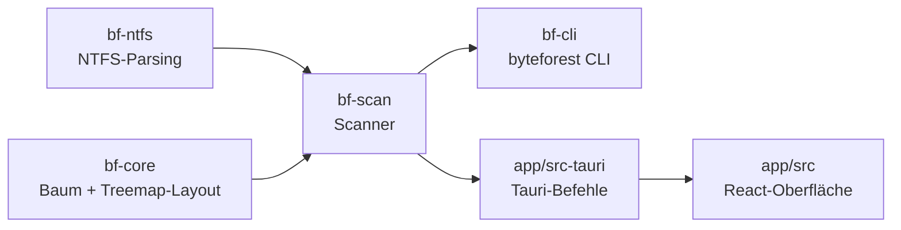

<p align="center">
  
</p>

<h1 align="center">ByteForest</h1>

<p align="center"><b>Ein schneller Open-Source-Festplattenanalysator für Windows: In Sekunden sehen, was Ihr Laufwerk füllt.</b></p>

<p align="center"><a href="README.md">English</a> | <a href="README.ru.md">Русский</a> | <a href="README.kk.md">Қазақша</a> | <a href="README.zh-CN.md">简体中文</a> | <a href="README.es.md">Español</a> | <b>Deutsch</b> | <a href="README.ja.md">日本語</a></p>

<p align="center">
  <a href="https://github.com/ErnarIT12/byteforest/actions/workflows/ci.yml"></a>
  <a href="https://github.com/ErnarIT12/byteforest/releases"></a>
  <a href="#lizenz"></a>
  
</p>


*Die Screenshots zeigen fiktive Demodaten, die mit [`scripts/make-demo-data.ps1`](scripts/make-demo-data.ps1) erzeugt wurden.*

## Warum ByteForest

Auf NTFS-Laufwerken liest ByteForest die Master File Table (MFT) direkt, statt Windows nach jedem Ordner einzeln zu fragen. Das ist der Unterschied zwischen Sekunden und Minuten.

| Scan | Modus | Einträge | Zeit |
|---|---|---|---|
| `C:` auf einem Windows-11-PC | MFT (Eintrag für Eintrag), mit Administratorrechten | ~1,25 Mio. | ~2,2 s |
| GitHub-Actions-Runner | MFT | ~1,2 Mio. Dateien | 11,6 s |
| GitHub-Actions-Runner | Verzeichnisdurchlauf | ~1,2 Mio. Dateien | 541 s |

Ohne Administratorrechte weicht ByteForest auf einen normalen Verzeichnisdurchlauf aus, der deutlich langsamer ist. Das sind Messwerte einzelner Rechner, kein formaler Benchmark; messen Sie Ihren eigenen mit `byteforest bench` (siehe [Verwendung](#verwendung)).

## Funktionen

- **MFT-Scan** von NTFS-Laufwerken mit Administratorrechten.
- **Datensatzweiser Ausweichmodus**, wenn der Rohzugriff auf das Laufwerk blockiert ist (z. B. durch Anti-Cheat-Treiber): Die MFT wird Eintrag für Eintrag über das Dateisystem gelesen, was immer noch schnell ist.
- **Verzeichnisdurchlauf als Ausweichlösung** ohne Administratorrechte oder auf Nicht-NTFS-Laufwerken.
- **Ordnerbaum** mit Größe, Anteil am übergeordneten Ordner, Dateianzahl und Änderungsdatum.
- **Squarified Treemap** mit Zoom in Ordner, Brotkrumennavigation und Tooltips.
- **Synchronisierte Auswahl** zwischen Baum, Treemap und Statusleiste.
- **Schaltfläche „⚡ Fast scan (admin)“**: startet ByteForest mit Administratorrechten neu und setzt den Scan automatisch fort.
- Einstellung **„Always run as administrator“**, damit jeder Start schnell ist.
- **Helles und dunkles Design** in der Farbpalette des Logos mit WCAG-AA-Kontrast.
- **Kommandozeilenwerkzeug** für Laufwerke, Scans und Benchmarks.


## Installation

1. Öffnen Sie die Seite [Releases](https://github.com/ErnarIT12/byteforest/releases).
2. Laden Sie eines der folgenden herunter:
   - das Installationsprogramm: `ByteForest_<Version>_x64-setup.exe` (NSIS) oder `ByteForest_<Version>_x64_en-US.msi`;
   - das portable Kommandozeilenwerkzeug: `byteforest-cli-v<Version>-x64.zip`.
3. Optional prüfen Sie den Download mit `SHA256SUMS.txt` aus demselben Release: `Get-FileHash <Datei> -Algorithm SHA256`.

Die Builds sind **noch nicht code-signiert**, daher zeigt Windows SmartScreen eine Warnung. Wählen Sie „Weitere Informationen“ und dann „Trotzdem ausführen“, wenn Sie dem Download vertrauen.

Das Installationsprogramm installiert ByteForest für alle Benutzer in Program Files.

Voraussetzungen: Windows 10/11 x64 und WebView2 (unter Windows 11 vorinstalliert; unter Windows 10 lädt das Installationsprogramm es bei Bedarf nach).

## Verwendung

**App.** Wählen Sie ein Laufwerk und klicken Sie auf **Scan**, oder auf **⚡ Fast scan (admin)**, um mit erhöhten Rechten neu zu starten und sofort zu scannen. Wählen Sie Ordner im Baum oder Rechtecke in der Treemap (beides bleibt synchron). Ein Klick auf einen Ordner in der Treemap zoomt hinein; zurück geht es über die Brotkrumen, den Aufwärtspfeil oder das Mausrad.

**CLI.**

```text
byteforest drives                    # verfügbare Laufwerke auflisten
byteforest scan C: --top 20          # scannen und die 20 größten Elemente ausgeben
byteforest scan C: --top 20 --json   # dasselbe als JSON
byteforest bench C: --runs 3         # den Scan dreimal messen
```

Starten Sie die CLI in einem Terminal mit Administratorrechten, um den MFT-Scanner zu nutzen.

## Aus dem Quellcode bauen

Voraussetzungen: Rust (die Toolchain ist in `rust-toolchain.toml` festgelegt), Visual Studio Build Tools mit MSVC-x64-Toolchain und Windows SDK sowie Node.js LTS.

```powershell
git clone https://github.com/ErnarIT12/byteforest.git
cd byteforest
npm --prefix app ci
npm --prefix app run tauri build   # Installationsprogramme
cargo test --workspace             # Tests (zuerst das Frontend bauen: npm --prefix app run build)
```

Der Entwicklungsablauf und die Tests, die Administratorrechte brauchen, stehen in [CONTRIBUTING.md](CONTRIBUTING.md).

## Architektur



- `bf-ntfs`: reines NTFS-Parsing auf Byte-Slices, ohne Windows-APIs.
- `bf-core`: Baummodell, Größenaggregate und Treemap-Layout, ohne Windows-APIs.
- `bf-scan`: `MftScanner` und `WalkScanner` sowie die automatische Moduswahl.
- `bf-cli`: das Kommandozeilenwerkzeug `byteforest`.
- `app`: Tauri-Hülle (`src-tauri`) und React-/TypeScript-Oberfläche (`src`).

Der gescannte Baum bleibt in Rust. Die Oberfläche fragt nur Ausschnitte ab: die Kinder eines Ordners (höchstens 1000 Knoten) oder die Rechtecke einer Treemap-Ansicht (höchstens 20 000).

## Datenschutz

ByteForest arbeitet vollständig offline. Es gibt keine Telemetrie und der Code macht keine Netzwerkaufrufe; das App-Fenster darf nur mit dem lokalen Rust-Backend kommunizieren (die Content Security Policy erlaubt nichts anderes). Einstellungen liegen in `%APPDATA%\ByteForest\settings.json`, Logs in `%LOCALAPPDATA%\ByteForest\logs`, beides auf Ihrem Rechner.

## Roadmap

- Speicherverbrauch von höchstens 120 Byte pro Eintrag (heute etwa 400).
- Suche und Sortierung.
- Detailbereich.
- In den Papierkorb verschieben.
- Lokalisierte Oberfläche.

## Mitwirken

Issues und Pull Requests sind willkommen. Bitte lesen Sie zuerst [CONTRIBUTING.md](CONTRIBUTING.md) und den [Verhaltenskodex](CODE_OF_CONDUCT.md).

## Sicherheit

Bitte melden Sie Sicherheitslücken privat, wie in [SECURITY.md](SECURITY.md) beschrieben.

## Lizenz

Lizenziert nach Ihrer Wahl unter einer der folgenden Lizenzen:

- Apache License, Version 2.0 ([LICENSE-APACHE](LICENSE-APACHE))
- MIT-Lizenz ([LICENSE-MIT](LICENSE-MIT))

Sofern Sie nicht ausdrücklich etwas anderes erklären, wird jeder Beitrag, der absichtlich zur Aufnahme in das Projekt eingereicht wird, wie oben doppelt lizenziert, ohne zusätzliche Bedingungen.

## Danksagung

Inspiriert von Festplattenanalysatoren wie WinDirStat und WizTree.
