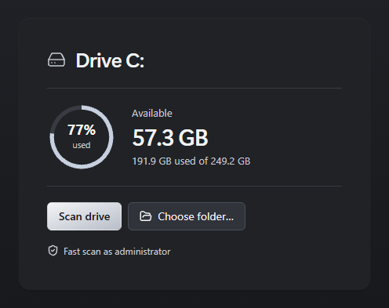
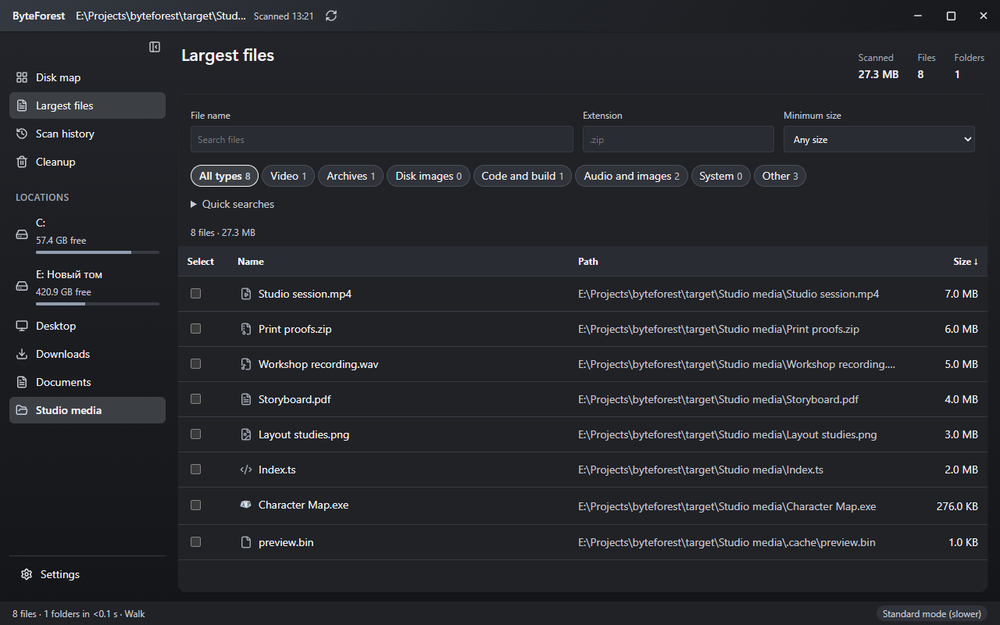
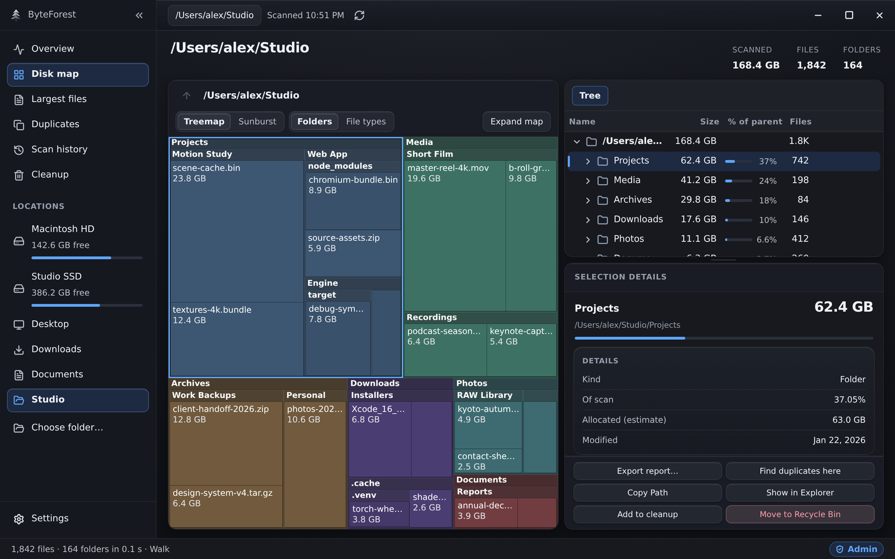
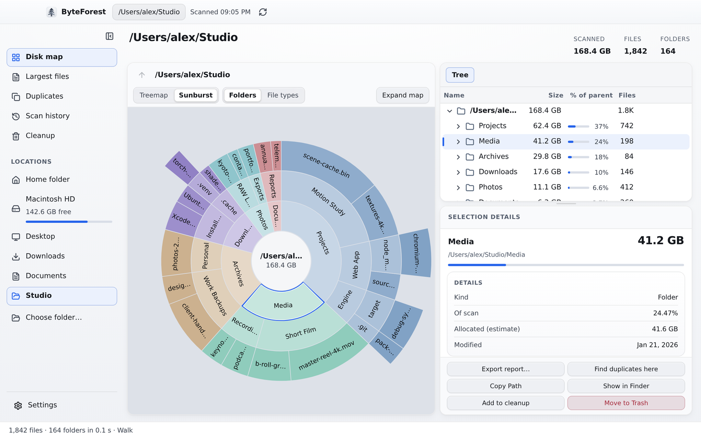
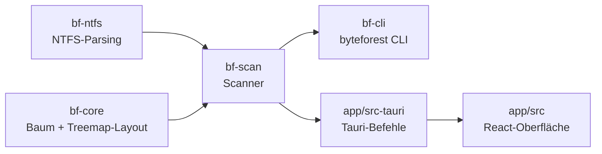

<p align="center">
  
</p>

<h1 align="center">ByteForest</h1>

<p align="center"><b>Ein schneller Open-Source-Analysator für die Speicherbelegung unter Windows und macOS.</b></p>

<p align="center"><a href="README.md">English</a> | <a href="README.ru.md">Русский</a> | <a href="README.kk.md">Қазақша</a> | <a href="README.zh-CN.md">简体中文</a> | <a href="README.es.md">Español</a> | <b>Deutsch</b> | <a href="README.ja.md">日本語</a></p>

<p align="center">
  <a href="https://github.com/ErnarIT12/byteforest/actions/workflows/ci.yml"></a>
  <a href="https://github.com/ErnarIT12/byteforest/releases"></a>
  <a href="#lizenz"></a>
  
  
</p>

## Der erste Scan

1. [ByteForest herunterladen](https://github.com/ErnarIT12/ByteForest/releases).
2. Mit **Choose folder…** analysierst du einen Ordner, mit **Scan drive** das ausgewählte Laufwerk.
3. Öffne einen Ordner in der Karte per Doppelklick. Über die Pfadleiste gelangst du zurück.



## Große Dateien

Öffnen Sie **Largest files**, um nach Typ oder Größe zu filtern. Markieren Sie Dateien und prüfen Sie unter **Cleanup** die Pfade, bevor Sie die Auswahl in den Papierkorb verschieben.





*Die Screenshots wurden unter macOS mit fiktiven Demodaten aufgenommen.*

## Blitzschnelles Scannen: MFT und Verzeichnisdurchlauf, mit Ausschlüssen

Auf NTFS-Laufwerken liest ByteForest die Master File Table (MFT) direkt, statt Windows nach jedem Ordner einzeln zu fragen. Das ist der Unterschied zwischen Sekunden und Minuten.

| Scan | Modus | Einträge | Zeit |
|---|---|---|---|
| `C:` auf einem Windows-11-PC | MFT (Eintrag für Eintrag), mit Administratorrechten | ~1,25 Mio. | ~2,2 s |
| GitHub-Actions-Runner | MFT | ~1,2 Mio. Dateien | 11,6 s |
| GitHub-Actions-Runner | Verzeichnisdurchlauf | ~1,2 Mio. Dateien | 541 s |

Das sind Messwerte einzelner Rechner, kein formaler Benchmark; messen Sie Ihren eigenen mit `byteforest bench` (siehe [Verwendung](#verwendung)).

- **MFT-Scan** von NTFS-Laufwerken. Er erfordert Windows und Administratorrechte.
- **Datensatzweiser Ausweichmodus**, wenn der Rohzugriff auf das Laufwerk blockiert ist (z. B. durch Anti-Cheat-Treiber): Die MFT wird Eintrag für Eintrag über das Dateisystem gelesen, was immer noch schnell ist.
- **Verzeichnisdurchlauf** ohne Administratorrechte, auf Nicht-NTFS-Laufwerken und unter macOS, wo es keinen MFT-Scan gibt. Auf großen Laufwerken ist er deutlich langsamer.
- **Schaltfläche „Fast scan (admin)“** (Windows): startet ByteForest mit Administratorrechten neu und setzt den Scan automatisch fort. Die Einstellung **„Always run as administrator“** macht jeden Start schnell.
- **Scan-Ausschlüsse**: In den Einstellungen lassen sich Namen und Muster (`*` und `?`, etwa `node_modules` oder `*.tmp`) ausschließen, die in jedem Ordner greifen, oder ein absoluter Pfad unterhalb des Scan-Ordners. Ausgeschlossenes zählt in keiner Summe mit, und die Statusleiste zeigt, wie viel ausgelassen wurde.
- **Suche im gesamten Scan** unter **Largest Files** nach Name, Erweiterung und Mindestgröße sowie Suchvorlagen mit einem Klick für typische Platzfresser (`node_modules`, `target`, `.venv`, `.git`, Datenträgerabbilder, Dateien über 1 GB) mit der Gesamtgröße, die sich freigeben lässt.
- **CSV- und JSON-Berichte** zu jedem Ordner für Tabellenkalkulationen und Skripte (**Export report…**).
- **Kommandozeilenwerkzeug** für Laufwerke, Scans, Snapshots, Ausschlüsse, Berichte und Benchmarks.

## Interaktive Erkundung mit Treemap und Sunburst

- **Ordnerbaum** mit Größe, Anteil am übergeordneten Ordner, Dateianzahl und Änderungsdatum.
- **Squarified Treemap** und **Sunburst-Diagramm**, umschaltbar über **Treemap | Sunburst** über der Karte. Beide bieten Zoom in Ordner, Brotkrumennavigation, Tooltips, Tastaturbedienung und das Kontextmenü.
- **Synchronisierte Auswahl** zwischen Baum, Karte und Statusleiste. Ein Doppelklick öffnet einen Ordner; zurück geht es über die Brotkrumen, den Aufwärtspfeil oder das Mausrad.
- **Aufschlüsselung nach Dateityp** für den gewählten Ordner (Kategorien und häufigste Erweiterungen) und der Farbmodus **Folders / File types** für die Karten, mit Legende.
- **Kontextmenü** per Rechtsklick (auch Umschalt+F10) im Baum und auf den Karten: öffnen, im Explorer/Finder anzeigen, Pfad kopieren oder nach Bestätigung in den Papierkorb verschieben. Alles aktualisiert sich sofort, ohne neuen Scan.



## Cleanup, automatische Snapshots und Vergleich

- **Cleanup (Ablagestapel)**: Dateien und Ordner aus Baum, Karten oder Inspektor vormerken (Entf-Taste oder Rechtsklick), die laufende Summe unter Cleanup prüfen und alles in einem bestätigten Schritt in den Papierkorb verschieben. Bis zur Bestätigung wird nichts gelöscht; Elemente, die sich nicht verschieben lassen, bleiben mit Begründung vorgemerkt.
- **Snapshots**: Speichern Sie einen Scan in einer kleinen `.bfsnap`-Datei und vergleichen Sie einen späteren Scan damit, um zu sehen, was gewachsen, geschrumpft oder neu ist. Die Ansicht Changes listet die größten Zuwächse auf.
- **Vergleichshervorhebung auf beiden Karten**: Beim Vergleich werden gewachsene, neue und geschrumpfte Elemente in Treemap und Sunburst umrandet (durchgezogen, gepunktet bzw. gestrichelt, mit der Größenänderung als Beschriftung).
- **Automatische Snapshots**: Jeder abgeschlossene Scan wird im Hintergrund gespeichert (standardmäßig die letzten 10; in den Einstellungen 0 bis 50 oder aus). Öffnen Sie einen in der Seitenleiste sofort und schreibgeschützt, ohne neu zu scannen, oder vergleichen Sie ihn mit dem aktuellen Scan.
- **Vergleich in der CLI**: `byteforest scan <target> --save-snapshot <FILE>` und `--diff <FILE>` (siehe [Verwendung](#verwendung)).

## Minimalistische Oberfläche und 100 % Datenschutz offline

- **Minimalistische, von Radix inspirierte Oberfläche** mit einer einheitlichen linken Seitenleiste: Laufwerke, Desktop, Downloads und Dokumente, zuletzt gescannte Orte und der Cleanup; sie lässt sich zu einer Symbolleiste einklappen.
- Designs **Graphite (dunkel, Standard) und Silver (hell)** oder Anpassung an das System, mit WCAG-AA-Kontrast. Hover-Effekte beachten die Einstellung für reduzierte Bewegung.
- **Arbeitet vollständig offline.** Es gibt keine Telemetrie, kein Konto und keine Update-Prüfung, und der Code stellt keine Netzwerkanfragen. Das App-Fenster darf nur mit dem lokalen Rust-Backend kommunizieren; die Content Security Policy erlaubt nichts anderes.
- **Ihre Daten bleiben auf Ihrem Rechner.** Einstellungen liegen in `%APPDATA%\ByteForest\settings.json`, Logs in `%LOCALAPPDATA%\ByteForest\logs`. Automatische Snapshots (Namen und Größen gescannter Elemente) liegen unter `%LOCALAPPDATA%\dev.byteforest.app\snapshots\auto` (`~/Library/Application Support/dev.byteforest.app/snapshots/auto` unter macOS) und lassen sich in den Einstellungen abschalten oder begrenzen.

## Installation

1. Öffnen Sie die Seite [Releases](https://github.com/ErnarIT12/byteforest/releases).
2. Laden Sie eines der folgenden herunter:
   - das Installationsprogramm: `ByteForest_<Version>_x64-setup.exe` (NSIS) oder `ByteForest_<Version>_x64_en-US.msi`;
   - das portable Kommandozeilenwerkzeug: `byteforest-cli-v<Version>-x64.zip`.
3. Optional prüfen Sie den Download mit `SHA256SUMS.txt` aus demselben Release: `Get-FileHash <Datei> -Algorithm SHA256`.

Die Builds sind **noch nicht code-signiert**, daher zeigt Windows SmartScreen eine Warnung. Wählen Sie „Weitere Informationen“ und dann „Trotzdem ausführen“, wenn Sie dem Download vertrauen.

Das Installationsprogramm installiert ByteForest für alle Benutzer in Program Files.

Voraussetzungen: Windows 10/11 x64 und WebView2 (unter Windows 11 vorinstalliert; unter Windows 10 lädt das Installationsprogramm es bei Bedarf nach).

### macOS-Beta

Laden Sie das universelle DMG von [GitHub Releases](https://github.com/ErnarIT12/byteforest/releases) herunter, prüfen Sie es mit SHA256SUMS.txt und ziehen Sie ByteForest in den Ordner „Programme“. Die Beta erfordert macOS 15 oder neuer und unterstützt Apple Silicon und Intel. Die App ist ad hoc signiert. Da sie nicht von Apple notarisiert ist, verlangt Gatekeeper beim ersten Start unter „Datenschutz & Sicherheit“ unter Umständen eine Freigabe. [Anleitung von Apple zum ersten Start](https://support.apple.com/en-us/102445)

ByteForest bietet Ihren Home-Ordner, das Mac-Datenvolume, lokal eingebundene Laufwerke und eine native Ordnerauswahl an. Es durchläuft Verzeichnisse mit den Rechten des aktuellen Benutzers. Übersprungene Einträge werden in der Statusleiste gemeldet. Belegte Größen sind Schätzwerte. APFS-Klone, gemeinsam genutzte Blöcke und Snapshots können dazu führen, dass die Scan-Summen von der Volume-Belegung abweichen.

## Verwendung

Öffnen Sie nach dem Scan **Largest Files**, um über alle gescannten Ordner hinweg nach Name, Erweiterung oder Größe zu suchen. Wählen Sie ein Ergebnis, um im Baum und auf der Karte dorthin zu springen. Wählen Sie eine Datei oder einen Ordner, um den Pfad zu kopieren oder ihn im Explorer oder Finder anzuzeigen.

**App.** Wählen Sie ein Laufwerk und klicken Sie auf **Scan**, oder auf **Fast scan (admin)**, um mit erhöhten Rechten neu zu starten und sofort zu scannen. Wählen Sie Ordner im Baum oder Rechtecke in der Treemap (beides bleibt synchron). Ein Doppelklick auf einen Ordner in der Treemap zoomt hinein; zurück geht es über die Brotkrumen, den Aufwärtspfeil oder das Mausrad.

**Ausschlüsse.** Fügen Sie in den Einstellungen (**Excluded from scans**) Namen oder Muster (`node_modules`, `*.tmp`, `$RECYCLE.BIN`) hinzu, die in jedem Ordner greifen. Ein vollständiger Pfad (`C:\Windows\WinSxS`) schließt nur diesen Ordner aus. Die Regeln gelten ab dem nächsten Scan; Pfade außerhalb des gescannten Ortes werden ignoriert. Die Statusleiste zeigt, wie viel ausgelassen wurde.

**CLI.**

```text
byteforest drives                    # verfügbare Laufwerke auflisten
byteforest scan C: --top 20          # scannen und die 20 größten Elemente ausgeben
byteforest scan C: --top 20 --json   # dasselbe als JSON
byteforest bench C: --runs 3         # den Scan dreimal messen
byteforest scan C: --save-snapshot before.bfsnap                         # Snapshot des Scans speichern
byteforest scan C: --diff before.bfsnap                                  # zeigen, was sich seit dem Snapshot geändert hat
byteforest scan C: --exclude node_modules --exclude "C:\Windows\WinSxS"  # Namen und Pfade auslassen
byteforest scan D:\Projects --export report.csv --export-depth 3         # CSV-Bericht schreiben (auch .json)
```

Starten Sie die CLI in einem Terminal mit Administratorrechten, um den MFT-Scanner zu nutzen.

## Aus dem Quellcode bauen

Voraussetzungen: Rust (die Toolchain ist in `rust-toolchain.toml` festgelegt), Visual Studio Build Tools mit MSVC-x64-Toolchain und Windows SDK sowie Node.js LTS.

```powershell
git clone https://github.com/ErnarIT12/byteforest.git
cd byteforest
npm --prefix app ci
npm --prefix app run tauri build   # Installationsprogramme
cargo test --workspace             # Tests (zuerst das Frontend bauen: npm --prefix app run build)
```

Der Entwicklungsablauf und die Tests, die Administratorrechte brauchen, stehen in [CONTRIBUTING.md](CONTRIBUTING.md).

Installieren Sie unter macOS die Xcode Command Line Tools und beide Rust-Targets und bauen Sie dann mit `npm --prefix app run tauri build -- --target universal-apple-darwin --bundles dmg`. Siehe die [Tauri-DMG-Anleitung](https://v2.tauri.app/distribute/dmg/).

## Architektur



- `bf-ntfs`: reines NTFS-Parsing auf Byte-Slices, ohne Windows-APIs.
- `bf-core`: Baummodell, Größenaggregate und Treemap-Layout, ohne Windows-APIs.
- `bf-scan`: `MftScanner` und `WalkScanner` sowie die automatische Moduswahl.
- `bf-cli`: das Kommandozeilenwerkzeug `byteforest`.
- `app`: Tauri-Hülle (`src-tauri`) und React-/TypeScript-Oberfläche (`src`).

Der gescannte Baum bleibt in Rust. Die Oberfläche fragt nur Ausschnitte ab: die Kinder eines Ordners (höchstens 1000 Knoten) oder die Rechtecke einer Treemap-Ansicht (höchstens 20 000).

## Roadmap

- Speicherverbrauch von höchstens 120 Byte pro Eintrag (heute etwa 400).
- Inkrementelle Neu-Scans über das NTFS-USN-Journal.
- Lokalisierte Oberfläche.

## Mitwirken

Issues und Pull Requests sind willkommen. Bitte lesen Sie zuerst [CONTRIBUTING.md](CONTRIBUTING.md) und den [Verhaltenskodex](CODE_OF_CONDUCT.md).

## Sicherheit

Bitte melden Sie Sicherheitslücken privat, wie in [SECURITY.md](SECURITY.md) beschrieben.

## Lizenz

Lizenziert nach Ihrer Wahl unter einer der folgenden Lizenzen:

- Apache License, Version 2.0 ([LICENSE-APACHE](LICENSE-APACHE))
- MIT-Lizenz ([LICENSE-MIT](LICENSE-MIT))

Sofern Sie nicht ausdrücklich etwas anderes erklären, wird jeder Beitrag, der absichtlich zur Aufnahme in das Projekt eingereicht wird, wie oben doppelt lizenziert, ohne zusätzliche Bedingungen.

## Danksagung

Inspiriert von Festplattenanalysatoren wie WinDirStat und WizTree. Die minimalistische Oberfläche orientiert sich in der Bedienung an [Radix](https://github.com/colinvkim/Radix) (MIT); Radix-Code wird nicht verwendet. Die Icons stammen von [Lucide](https://lucide.dev) (ISC).
