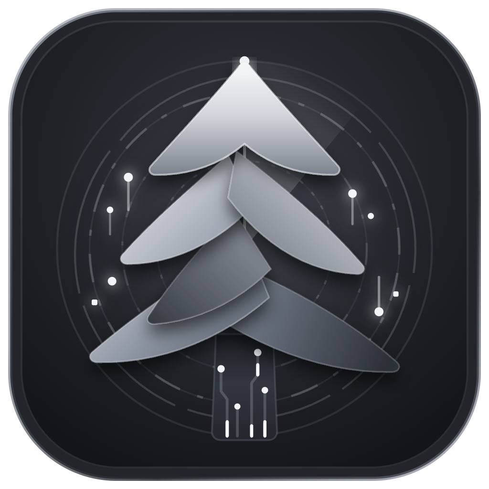
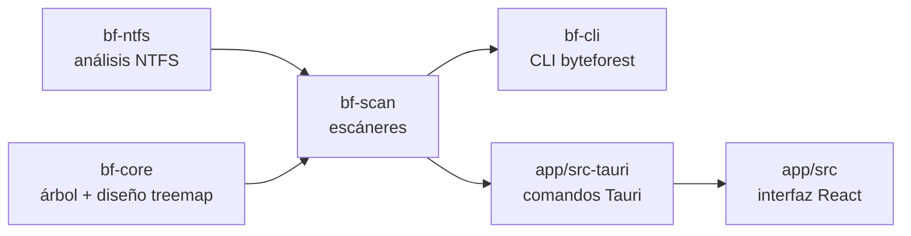

<p align="center">
  
</p>

<h1 align="center">ByteForest</h1>

<p align="center"><b>Un analizador de espacio en disco para Windows, rápido y de código abierto: descubre en segundos qué llena tu unidad.</b></p>

<p align="center"><a href="README.md">English</a> | <a href="README.ru.md">Русский</a> | <a href="README.kk.md">Қазақша</a> | <a href="README.zh-CN.md">简体中文</a> | <b>Español</b> | <a href="README.de.md">Deutsch</a> | <a href="README.ja.md">日本語</a></p>

<p align="center">
  <a href="https://github.com/ErnarIT12/byteforest/actions/workflows/ci.yml"></a>
  <a href="https://github.com/ErnarIT12/byteforest/releases"></a>
  <a href="#licencia"></a>
  
</p>


*Las capturas muestran datos de demostración ficticios creados con [`scripts/make-demo-data.ps1`](scripts/make-demo-data.ps1).*

## Análisis ultrarrápido: MFT y recorrido de directorios, con exclusiones

En volúmenes NTFS, ByteForest lee directamente la Master File Table (MFT) en lugar de preguntarle a Windows por cada carpeta, una a una. Esa es la diferencia entre segundos y minutos.

| Análisis | Modo | Entradas | Tiempo |
|---|---|---|---|
| `C:` en un PC con Windows 11 | MFT (registro a registro), con permisos de administrador | ~1,25 millones | ~2,2 s |
| Runner de GitHub Actions | MFT | ~1,2 millones de archivos | 11,6 s |
| Runner de GitHub Actions | Recorrido de directorios | ~1,2 millones de archivos | 541 s |

Son cifras de máquinas concretas, no un benchmark formal; mide las tuyas con `byteforest bench` (consulta [Uso](#uso)).

- **Análisis de la MFT** en volúmenes NTFS. Requiere Windows y permisos de administrador.
- **Modo alternativo registro a registro** cuando la lectura directa del volumen está bloqueada (por ejemplo, por controladores anti-cheat): la MFT se lee un registro cada vez a través del sistema de archivos, y sigue siendo rápido.
- **Recorrido de directorios** sin permisos de administrador, en volúmenes que no son NTFS y siempre en macOS, donde no hay análisis de la MFT. En volúmenes grandes es mucho más lento.
- **Botón «Fast scan (admin)»** (Windows): reinicia ByteForest con permisos de administrador y reanuda el análisis automáticamente. El ajuste **«Always run as administrator»** hace que todos los inicios sean rápidos.
- **Exclusiones del análisis**: en Ajustes puedes dejar fuera nombres y patrones (`*` y `?`, como `node_modules` o `*.tmp`) que coinciden en cualquier carpeta, o una ruta absoluta dentro de la carpeta analizada. Lo excluido no cuenta en ningún total y la barra de estado indica cuánto se ha dejado fuera.
- **Búsqueda en todo el análisis** en **Largest Files** por nombre, extensión y tamaño mínimo, además de ajustes preestablecidos de un clic para los habituales devoradores de espacio (`node_modules`, `target`, `.venv`, `.git`, imágenes de disco, archivos de más de 1 GB) con el tamaño total que podrías recuperar.
- **Informes CSV y JSON** de cualquier carpeta para hojas de cálculo y scripts (**Export report…**).
- **Herramienta de línea de comandos** para unidades, análisis, instantáneas, exclusiones, informes y benchmarks.

## Exploración interactiva con Treemap y Sunburst

- **Árbol de carpetas** con tamaño, porcentaje respecto a la carpeta superior, número de archivos y fecha de modificación.
- **Treemap squarified** y **gráfico Sunburst**, que se alternan con **Treemap | Sunburst** en la barra superior. Ambos permiten hacer zoom en una carpeta y ofrecen migas de pan, información emergente, navegación con teclado y menú contextual.
- **Selección sincronizada** entre el árbol, el mapa y la barra de estado. Un doble clic abre una carpeta; para volver atrás usa las migas de pan, la flecha hacia arriba o la rueda del ratón.
- **Desglose por tipo de archivo** de la carpeta seleccionada (categorías y extensiones principales) y modo de color **Folders / File types** para los mapas, con leyenda.
- **Menú contextual** con clic derecho (también Mayús+F10) en el árbol y en los mapas: abrir, mostrar en el Explorador/Finder, copiar la ruta o mover a la Papelera tras confirmar. Todo se actualiza al instante, sin volver a analizar.


## Discard Pile, instantáneas automáticas y comparación

- **Discard Pile (pila de descarte)**: pon en cola archivos y carpetas desde el árbol, los mapas o el inspector (tecla Supr o clic derecho), consulta el total acumulado en la barra lateral y mueve todo a la Papelera en un solo paso confirmado. No se borra nada hasta que confirmes, y lo que no se pueda mover permanece en la cola con el motivo.
- **Instantáneas**: guarda un análisis en un archivo `.bfsnap` pequeño y compara con él un análisis posterior para ver qué ha crecido, disminuido o es nuevo. La vista Changes enumera los mayores aumentos.
- **Resaltado de diferencias en ambos mapas**: al comparar, los elementos que han crecido, los nuevos y los que han disminuido se perfilan en el treemap y en el sunburst (trazo continuo, punteado y discontinuo, con el cambio de tamaño como etiqueta).
- **Instantáneas automáticas**: cada análisis terminado se guarda en segundo plano (se conservan las últimas 10 por defecto; de 0 a 50 u Off en Ajustes). Reabre una desde la barra lateral al instante y en solo lectura, sin volver a analizar, o compárala con el análisis actual.
- **Comparación desde la CLI**: `byteforest scan <target> --save-snapshot <FILE>` y `--diff <FILE>` (consulta [Uso](#uso)).

## Interfaz minimalista y privacidad 100 % sin conexión

- **Interfaz minimalista inspirada en Radix** con una barra lateral izquierda unificada: tus unidades, Escritorio, Descargas y Documentos, análisis recientes y la Discard Pile; se contrae en una columna de iconos.
- Temas **Graphite (oscuro, el predeterminado) y Silver (claro)**, o seguir el del sistema, con contraste WCAG AA. Los efectos al pasar el cursor respetan el ajuste de movimiento reducido.
- **Funciona totalmente sin conexión.** No hay telemetría, ni cuenta, ni comprobación de actualizaciones, y el código no hace peticiones de red. La ventana de la aplicación solo puede comunicarse con el backend local de Rust; la Content Security Policy no permite nada más.
- **Tus datos se quedan en tu equipo.** Los ajustes se guardan en `%APPDATA%\ByteForest\settings.json` y los registros en `%LOCALAPPDATA%\ByteForest\logs`. Las instantáneas automáticas (nombres y tamaños de los elementos analizados) se guardan en `%LOCALAPPDATA%\dev.byteforest.app\snapshots\auto` (`~/Library/Application Support/dev.byteforest.app/snapshots/auto` en macOS) y se pueden desactivar o limitar en Ajustes.

## Instalación

1. Abre la página de [Releases](https://github.com/ErnarIT12/byteforest/releases).
2. Descarga uno de estos:
   - el instalador: `ByteForest_<versión>_x64-setup.exe` (NSIS) o `ByteForest_<versión>_x64_en-US.msi`;
   - la herramienta de línea de comandos portátil: `byteforest-cli-v<versión>-x64.zip`.
3. Si quieres, verifica la descarga con `SHA256SUMS.txt` de la misma versión: `Get-FileHash <archivo> -Algorithm SHA256`.

Las compilaciones **aún no están firmadas**, así que Windows SmartScreen mostrará una advertencia. Elige «Más información» y después «Ejecutar de todas formas» si confías en la descarga.

El instalador instala ByteForest para todos los usuarios, en Program Files.

Requisitos: Windows 10/11 x64 y WebView2 (viene preinstalado en Windows 11; en Windows 10 el instalador lo descarga si falta).

### Beta para macOS

Descarga el DMG universal desde [GitHub Releases](https://github.com/ErnarIT12/byteforest/releases), verifícalo con SHA256SUMS.txt y arrastra ByteForest a Aplicaciones. La beta requiere macOS 15 o posterior y es compatible con Apple Silicon e Intel. La aplicación está firmada ad hoc. Como no está notarizada por Apple, es posible que Gatekeeper te pida aprobar el primer inicio en Privacidad y seguridad. [Instrucciones de Apple para el primer inicio](https://support.apple.com/en-us/102445)

ByteForest ofrece tu carpeta personal, el volumen de datos del Mac, los discos montados localmente y un selector de carpetas nativo. Recorre los directorios con los permisos del usuario actual. Las entradas omitidas se indican en la barra de estado. Los tamaños asignados son estimaciones. Los clones de APFS, los bloques compartidos y las instantáneas pueden hacer que los totales del análisis difieran del uso del volumen.

## Uso

Después de analizar, abre **Largest Files** para buscar por nombre, extensión o tamaño en todas las carpetas analizadas. Elige un resultado para saltar a él en el árbol y en el mapa. Selecciona un archivo o una carpeta para copiar su ruta o mostrarlo en el Explorador o en Finder.

**Aplicación.** Elige una unidad y pulsa **Scan**, o pulsa **Fast scan (admin)** para reiniciar con permisos elevados y analizar de inmediato. Selecciona carpetas en el árbol o rectángulos en el treemap (ambos se mantienen sincronizados). Haz doble clic en una carpeta del treemap para hacer zoom; vuelve atrás con las migas de pan, la flecha hacia arriba o la rueda del ratón.

**Exclusiones.** En los ajustes (**Excluded from scans**) añade nombres o patrones (`node_modules`, `*.tmp`, `$RECYCLE.BIN`) que coinciden en cualquier carpeta. Una ruta completa (`C:\Windows\WinSxS`) excluye solo esa carpeta. Las reglas se aplican desde el siguiente análisis; las rutas fuera de la ubicación analizada se ignoran. La barra de estado indica cuánto se dejó fuera.

**CLI.**

```text
byteforest drives                    # lista las unidades disponibles
byteforest scan C: --top 20          # analiza e imprime los 20 elementos más grandes
byteforest scan C: --top 20 --json   # lo mismo, en JSON
byteforest bench C: --runs 3         # mide el análisis tres veces
byteforest scan C: --save-snapshot before.bfsnap                         # guarda una instantánea del análisis
byteforest scan C: --diff before.bfsnap                                  # muestra qué cambió desde la instantánea
byteforest scan C: --exclude node_modules --exclude "C:\Windows\WinSxS"  # omite nombres y rutas
byteforest scan D:\Projects --export report.csv --export-depth 3         # escribe un informe CSV (también .json)
```

Ejecuta la CLI desde un terminal con permisos de administrador para usar el escáner MFT.

## Compilar desde el código fuente

Requisitos previos: Rust (la toolchain está fijada en `rust-toolchain.toml`), Visual Studio Build Tools con la toolchain MSVC x64 y un SDK de Windows, y Node.js LTS.

```powershell
git clone https://github.com/ErnarIT12/byteforest.git
cd byteforest
npm --prefix app ci
npm --prefix app run tauri build   # instaladores
cargo test --workspace             # pruebas (compila antes el frontend: npm --prefix app run build)
```

El flujo de desarrollo y las pruebas que requieren administrador están en [CONTRIBUTING.md](CONTRIBUTING.md).

En macOS, instala las Xcode Command Line Tools y los dos destinos de Rust, y compila con `npm --prefix app run tauri build -- --target universal-apple-darwin --bundles dmg`. Consulta la [guía de DMG de Tauri](https://v2.tauri.app/distribute/dmg/).

## Arquitectura



- `bf-ntfs`: análisis puro de NTFS sobre segmentos de bytes, sin APIs de Windows.
- `bf-core`: modelo de árbol, agregados de tamaño y diseño del treemap, sin APIs de Windows.
- `bf-scan`: `MftScanner` y `WalkScanner`, además de la selección automática de modo.
- `bf-cli`: la herramienta de línea de comandos `byteforest`.
- `app`: shell de Tauri (`src-tauri`) e interfaz en React + TypeScript (`src`).

El árbol analizado se queda en Rust. La interfaz solo pide fragmentos: los hijos de una carpeta (como máximo 1000 nodos) o los rectángulos de una vista del treemap (como máximo 20 000).

## Hoja de ruta

- Uso de memoria de 120 bytes por entrada o menos (hoy, unos 400).
- Reanálisis incrementales a partir del diario USN de NTFS.
- Interfaz localizada.

## Contribuir

Se agradecen los issues y los pull requests. Lee primero [CONTRIBUTING.md](CONTRIBUTING.md) y el [Código de conducta](CODE_OF_CONDUCT.md).

## Seguridad

Informa de las vulnerabilidades de forma privada, como se describe en [SECURITY.md](SECURITY.md).

## Licencia

Se distribuye, a tu elección, bajo cualquiera de estas licencias:

- Apache License, Version 2.0 ([LICENSE-APACHE](LICENSE-APACHE))
- licencia MIT ([LICENSE-MIT](LICENSE-MIT))

Salvo que indiques expresamente lo contrario, cualquier contribución enviada intencionadamente para su inclusión en la obra se licenciará de forma doble como arriba, sin términos ni condiciones adicionales.

## Agradecimientos

Inspirado en analizadores de disco como WinDirStat y WizTree. La interfaz minimalista toma su inspiración de UX de [Radix](https://github.com/colinvkim/Radix) (MIT); no se usa código de Radix. Los iconos proceden de [Lucide](https://lucide.dev) (ISC).
