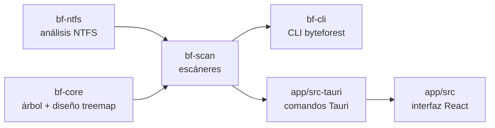

<p align="center">
  
</p>

<h1 align="center">ByteForest</h1>

<p align="center"><b>Un analizador de espacio en disco para Windows, rápido y de código abierto: descubre en segundos qué llena tu unidad.</b></p>

<p align="center"><a href="README.md">English</a> | <a href="README.ru.md">Русский</a> | <a href="README.kk.md">Қазақша</a> | <a href="README.zh-CN.md">简体中文</a> | <b>Español</b> | <a href="README.de.md">Deutsch</a> | <a href="README.ja.md">日本語</a></p>

<p align="center">
  <a href="https://github.com/ErnarIT12/byteforest/actions/workflows/ci.yml"></a>
  <a href="https://github.com/ErnarIT12/byteforest/releases"></a>
  <a href="#licencia"></a>
  
</p>


*Las capturas muestran datos de demostración ficticios creados con [`scripts/make-demo-data.ps1`](scripts/make-demo-data.ps1).*

## Por qué ByteForest

En volúmenes NTFS, ByteForest lee directamente la Master File Table (MFT) en lugar de preguntarle a Windows por cada carpeta, una a una. Esa es la diferencia entre segundos y minutos.

| Análisis | Modo | Entradas | Tiempo |
|---|---|---|---|
| `C:` en un PC con Windows 11 | MFT (registro a registro), con permisos de administrador | ~1,25 millones | ~2,2 s |
| Runner de GitHub Actions | MFT | ~1,2 millones de archivos | 11,6 s |
| Runner de GitHub Actions | Recorrido de directorios | ~1,2 millones de archivos | 541 s |

Sin permisos de administrador, ByteForest recurre a un recorrido normal de directorios, mucho más lento. Son cifras de máquinas concretas, no un benchmark formal; mide las tuyas con `byteforest bench` (consulta [Uso](#uso)).

## Características

- **Análisis de la MFT** de volúmenes NTFS con permisos de administrador.
- **Modo alternativo registro a registro** cuando la lectura directa del volumen está bloqueada (por ejemplo, por drivers anti-cheat): la MFT se lee un registro cada vez a través del sistema de archivos, y sigue siendo rápido.
- **Recorrido de directorios como alternativa** sin permisos de administrador o en volúmenes que no son NTFS.
- **Árbol de carpetas** con tamaño, proporción respecto al padre, número de archivos y fecha de modificación.
- **Treemap squarified** con zoom a una carpeta, migas de pan e información emergente.
- **Selección sincronizada** entre el árbol, el treemap y la barra de estado.
- **Botón «Fast scan (admin)»**: reinicia ByteForest con permisos de administrador y retoma el análisis automáticamente.
- Opción **«Always run as administrator»**, para que cada inicio sea rápido.
- Temas **Graphite (oscuro) y Silver (claro)**, o el del sistema, con contraste WCAG AA.
- **Menú contextual** (clic derecho) en el árbol de carpetas y el treemap: abrir, mostrar en el Explorador/Finder, copiar la ruta o mover a la Papelera tras confirmar. El árbol, el treemap y los totales se actualizan al instante, sin volver a analizar.
- **Discard Pile (pila de descarte)**: pon en cola archivos y carpetas desde el árbol, el treemap o el inspector (tecla Supr o clic derecho), revisa el total acumulado en la barra lateral y muévelo todo a la Papelera en un solo paso con confirmación. No se borra nada hasta que confirmes, y los elementos que no se puedan mover siguen en la cola.
- **Desglose por tipo de archivo** de la carpeta seleccionada (categorías y extensiones principales) y el modo de color del treemap **Folders / File types**.
- **Gráfico sunburst del disco** (selector Treemap | Sunburst en la barra superior) con el mismo zoom, selección, teclado y menú contextual, y **resaltado en el mapa al comparar con una instantánea**: los elementos que han crecido, nuevos o reducidos se enmarcan en el treemap y en el sunburst (línea continua, punteada o discontinua, con el cambio de tamaño como etiqueta).
- **Búsquedas predefinidas con un clic** para los devoradores de espacio habituales (`node_modules`, `target`, `.venv`, `.git`, imágenes de disco, archivos de más de 1 GB), con el tamaño total que se puede recuperar.
- **Barra lateral** con tus unidades, Escritorio, Descargas y Documentos, y con los análisis recientes para repetirlos con un clic.
- **Instantáneas y comparación**: guarda un análisis en un archivo pequeño y compáralo con uno posterior para ver qué creció, qué se redujo y qué es nuevo.
- **Instantáneas automáticas y reapertura inmediata**: cada análisis terminado se guarda en segundo plano (por defecto se conservan las últimas 10), así que puedes reabrirlo al instante desde la barra lateral, en solo lectura y sin volver a analizar, o compararlo con el análisis actual.
- **Exclusiones de análisis**: en los ajustes puedes excluir nombres, patrones (`node_modules`, `*.tmp`) o rutas completas. Lo excluido no cuenta en ningún total.
- **Informes CSV y JSON** de cualquier carpeta para hojas de cálculo y scripts (**Export report…**).
- **Herramienta de línea de comandos** para unidades, análisis, instantáneas, exclusiones, informes y mediciones.


## Instalación

1. Abre la página de [Releases](https://github.com/ErnarIT12/byteforest/releases).
2. Descarga uno de estos:
   - el instalador: `ByteForest_<versión>_x64-setup.exe` (NSIS) o `ByteForest_<versión>_x64_en-US.msi`;
   - la herramienta de línea de comandos portátil: `byteforest-cli-v<versión>-x64.zip`.
3. Si quieres, verifica la descarga con `SHA256SUMS.txt` de la misma versión: `Get-FileHash <archivo> -Algorithm SHA256`.

Las compilaciones **aún no están firmadas**, así que Windows SmartScreen mostrará una advertencia. Elige «Más información» y después «Ejecutar de todas formas» si confías en la descarga.

El instalador instala ByteForest para todos los usuarios, en Program Files.

Requisitos: Windows 10/11 x64 y WebView2 (viene preinstalado en Windows 11; en Windows 10 el instalador lo descarga si falta).

## Uso

**Aplicación.** Elige una unidad y pulsa **Scan**, o pulsa **Fast scan (admin)** para reiniciar con permisos elevados y analizar de inmediato. Selecciona carpetas en el árbol o rectángulos en el treemap (ambos se mantienen sincronizados). Haz doble clic en una carpeta del treemap para hacer zoom; vuelve atrás con las migas de pan, la flecha hacia arriba o la rueda del ratón.

**Exclusiones.** En los ajustes (**Excluded from scans**) añade nombres o patrones (`node_modules`, `*.tmp`, `$RECYCLE.BIN`) que coinciden en cualquier carpeta. Una ruta completa (`C:\Windows\WinSxS`) excluye solo esa carpeta. Las reglas se aplican desde el siguiente análisis; las rutas fuera de la ubicación analizada se ignoran. La barra de estado indica cuánto se dejó fuera.

**CLI.**

```text
byteforest drives                    # lista las unidades disponibles
byteforest scan C: --top 20          # analiza e imprime los 20 elementos más grandes
byteforest scan C: --top 20 --json   # lo mismo, en JSON
byteforest bench C: --runs 3         # mide el análisis tres veces
byteforest scan C: --save-snapshot before.bfsnap                         # guarda una instantánea del análisis
byteforest scan C: --diff before.bfsnap                                  # muestra qué cambió desde la instantánea
byteforest scan C: --exclude node_modules --exclude "C:\Windows\WinSxS"  # omite nombres y rutas
byteforest scan D:\Projects --export report.csv --export-depth 3         # escribe un informe CSV (también .json)
```

Ejecuta la CLI desde un terminal con permisos de administrador para usar el escáner MFT.

## Compilar desde el código fuente

Requisitos previos: Rust (la toolchain está fijada en `rust-toolchain.toml`), Visual Studio Build Tools con la toolchain MSVC x64 y un SDK de Windows, y Node.js LTS.

```powershell
git clone https://github.com/ErnarIT12/byteforest.git
cd byteforest
npm --prefix app ci
npm --prefix app run tauri build   # instaladores
cargo test --workspace             # pruebas (compila antes el frontend: npm --prefix app run build)
```

El flujo de desarrollo y las pruebas que requieren administrador están en [CONTRIBUTING.md](CONTRIBUTING.md).

## Arquitectura



- `bf-ntfs`: análisis puro de NTFS sobre segmentos de bytes, sin APIs de Windows.
- `bf-core`: modelo de árbol, agregados de tamaño y diseño del treemap, sin APIs de Windows.
- `bf-scan`: `MftScanner` y `WalkScanner`, además de la selección automática de modo.
- `bf-cli`: la herramienta de línea de comandos `byteforest`.
- `app`: shell de Tauri (`src-tauri`) e interfaz en React + TypeScript (`src`).

El árbol analizado se queda en Rust. La interfaz solo pide fragmentos: los hijos de una carpeta (como máximo 1000 nodos) o los rectángulos de una vista del treemap (como máximo 20 000).

## Privacidad

ByteForest funciona totalmente sin conexión. No tiene telemetría y su código no realiza llamadas de red; la ventana de la aplicación solo puede comunicarse con el backend local en Rust (la Content Security Policy no permite nada más). La configuración se guarda en `%APPDATA%\ByteForest\settings.json` y los registros en `%LOCALAPPDATA%\ByteForest\logs`, ambos en tu equipo. Las instantáneas automáticas (nombres y tamaños de los elementos analizados) se guardan solo en tu equipo, en `%LOCALAPPDATA%\dev.byteforest.app\snapshots\auto` (`~/Library/Application Support/dev.byteforest.app/snapshots/auto` en macOS), y se pueden desactivar o limitar en Ajustes.

## Hoja de ruta

- Uso de memoria de 120 bytes por entrada o menos (hoy unos 400).
- Vista Sunburst junto al treemap.
- Discard Pile: reunir elementos y eliminarlos juntos.
- Reanálisis incrementales con el diario USN de NTFS.
- Interfaz localizada.

## Contribuir

Se agradecen los issues y los pull requests. Lee primero [CONTRIBUTING.md](CONTRIBUTING.md) y el [Código de conducta](CODE_OF_CONDUCT.md).

## Seguridad

Informa de las vulnerabilidades de forma privada, como se describe en [SECURITY.md](SECURITY.md).

## Licencia

Se distribuye, a tu elección, bajo cualquiera de estas licencias:

- Apache License, Version 2.0 ([LICENSE-APACHE](LICENSE-APACHE))
- licencia MIT ([LICENSE-MIT](LICENSE-MIT))

Salvo que indiques expresamente lo contrario, cualquier contribución enviada intencionadamente para su inclusión en la obra se licenciará de forma doble como arriba, sin términos ni condiciones adicionales.

## Agradecimientos

Inspirado en analizadores de disco como WinDirStat, WizTree y [Radix](https://github.com/colinvkim/Radix).
