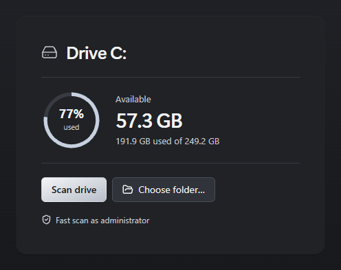
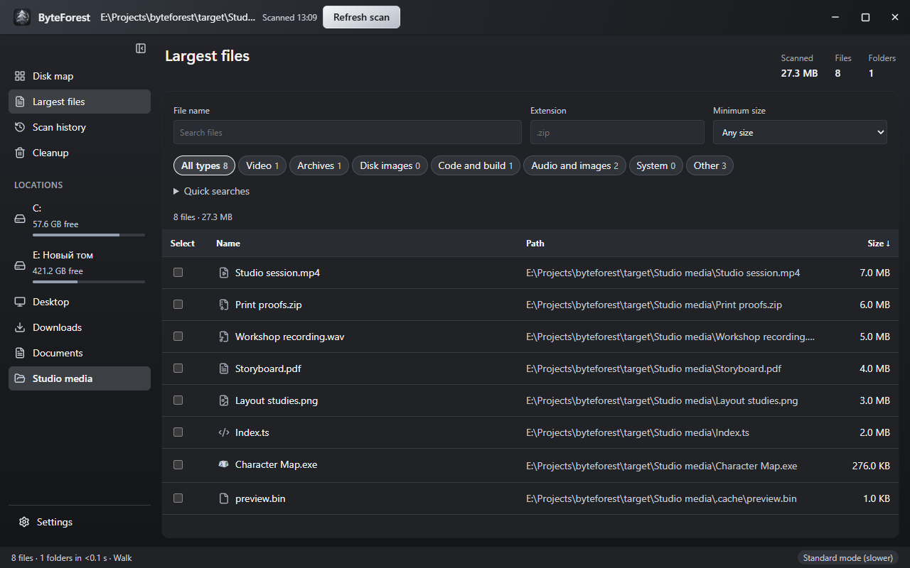
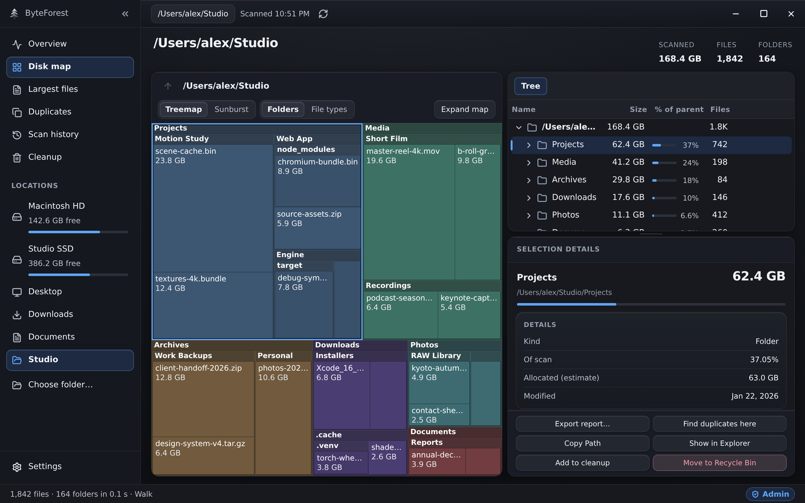
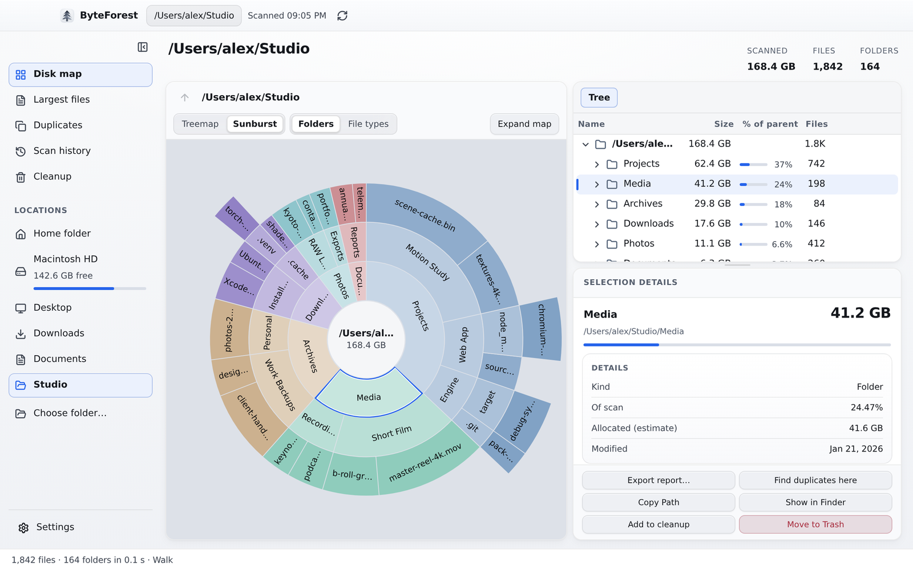
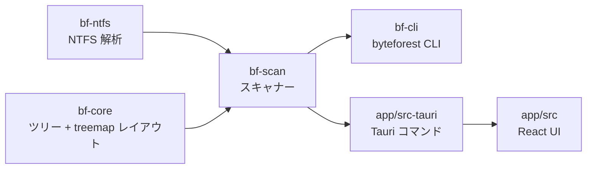

<p align="center">
  
</p>

<h1 align="center">ByteForest</h1>

<p align="center"><b>Windows と macOS に対応する高速なオープンソースのディスク使用量アナライザー。</b></p>

<p align="center"><a href="README.md">English</a> | <a href="README.ru.md">Русский</a> | <a href="README.kk.md">Қазақша</a> | <a href="README.zh-CN.md">简体中文</a> | <a href="README.es.md">Español</a> | <a href="README.de.md">Deutsch</a> | <b>日本語</b></p>

<p align="center">
  <a href="https://github.com/ErnarIT12/byteforest/actions/workflows/ci.yml"></a>
  <a href="https://github.com/ErnarIT12/byteforest/releases"></a>
  <a href="#ライセンス"></a>
  
  
</p>

## 初めてのスキャン

1. [ByteForest をダウンロード](https://github.com/ErnarIT12/ByteForest/releases).
2. **Choose folder…** でフォルダーを選ぶか、**Scan** で選択中のドライブをスキャンします。
3. マップ上のフォルダーをダブルクリックして開きます。上の階層に戻るには、マップの上にあるパスをクリックします。



## 大きなファイル

**Largest files** で種類やサイズを指定してファイルを絞り込みます。ファイルを選択したら、**Cleanup** でパスを確認してからごみ箱に移動できます。





*macOS で架空のデモデータを使って撮影したスクリーンショットです。*

## 圧倒的な速さのスキャン：MFT とディレクトリ走査、除外設定つき

NTFS ボリュームでは、ByteForest はフォルダーごとに Windows へ問い合わせる代わりに、マスターファイルテーブル（MFT）を直接読み取ります。これが数秒と数分の差になります。

| スキャン | モード | エントリ数 | 時間 |
|---|---|---|---|
| Windows 11 PC の `C:` | MFT（レコード単位）、管理者権限 | 約 125 万 | 約 2.2 秒 |
| GitHub Actions ランナー | MFT | 約 120 万ファイル | 11.6 秒 |
| GitHub Actions ランナー | ディレクトリ走査 | 約 120 万ファイル | 541 秒 |

これは個別のマシンでの数値であり、正式なベンチマークではありません。`byteforest bench` でご自身の環境を計測できます（[使い方](#使い方)を参照）。

- NTFS ボリュームの **MFT スキャン**。Windows と管理者権限が必要です。
- 生のボリューム読み取りがブロックされている場合（アンチチートドライバーなど）の**レコード単位のフォールバック**：MFT をファイルシステム経由で 1 レコードずつ読み取りますが、それでも高速です。
- 管理者権限がない場合、NTFS 以外のボリューム、そして MFT スキャンのない macOS では**ディレクトリ走査**を使います。大きなボリュームではかなり遅くなります。
- **「Fast scan (admin)」ボタン**（Windows）：ByteForest を管理者権限で再起動し、スキャンを自動的に再開します。**「Always run as administrator」**設定をオンにすると、毎回高速に起動できます。
- **スキャンの除外**：設定で、どのフォルダーでも一致する名前やパターン（`*` と `?`。例：`node_modules`、`*.tmp`）、またはスキャン対象フォルダー内の絶対パスを除外できます。除外したものはどの合計にも含まれず、ステータスバーに除外された量が表示されます。
- **スキャン全体の検索**：**Largest Files** で名前、拡張子、最小サイズから検索できるほか、容量を食いがちなもの（`node_modules`、`target`、`.venv`、`.git`、ディスクイメージ、1 GB を超えるファイル）をワンクリックで探すプリセットと、解放できる合計サイズの表示があります。
- 任意のフォルダーの **CSV / JSON レポート**。表計算ソフトやスクリプトで使えます（**Export report…**）。
- ドライブ、スキャン、スナップショット、除外、レポート、ベンチマーク用の**コマンドラインツール**。

## Treemap と Sunburst で探索

- サイズ、親フォルダーに対する割合、ファイル数、更新日を表示する**フォルダーツリー**。
- **Squarified treemap** と **Sunburst ディスクチャート**。マップ上部の **Treemap | Sunburst** で切り替えます。どちらもフォルダーへのズーム、パンくずリスト、ツールチップ、キーボード操作、コンテキストメニューに対応しています。
- ツリー、マップ、ステータスバーで**選択が同期**します。ダブルクリックでフォルダーを開き、パンくずリスト、上矢印、マウスホイールで戻れます。
- 選択したフォルダーの**ファイルタイプ別の内訳**（カテゴリと上位の拡張子）と、凡例つきでマップの色を切り替える **Folders / File types** モード。
- ツリーとマップの**右クリックメニュー**（Shift+F10 でも開けます）：開く、Explorer/Finder で表示、パスをコピー、確認後にごみ箱へ移動。再スキャンなしですぐに反映されます。



## Cleanup、自動スナップショット、差分比較

- **Cleanup（破棄リスト）**：ツリー、マップ、インスペクターからファイルやフォルダーをリストに追加し（Delete キーまたは右クリック）、Cleanup で合計サイズを確認して、確認のうえ一度にごみ箱へ移動します。確認するまで何も削除されず、移動できなかった項目は理由つきでリストに残ります。
- **スナップショット**：スキャン結果を小さな `.bfsnap` ファイルに保存し、後のスキャンと比較して、増えたもの、減ったもの、新しいものを確認できます。Changes ビューには増加量の大きい順に一覧表示されます。
- **両方のマップで差分をハイライト**：比較中は、増加・新規・減少した項目が treemap と sunburst で枠線表示されます（実線、点線、破線。サイズ変化をラベルで表示）。
- **自動スナップショット**：完了したスキャンはバックグラウンドで保存されます（既定では直近 10 件を保持。設定で 0〜50 件、またはオフ）。サイドバーから再スキャンなしで即座に読み取り専用で開くことも、現在のスキャンと比較することもできます。
- **CLI での差分**：`byteforest scan <target> --save-snapshot <FILE>` と `--diff <FILE>`（[使い方](#使い方)を参照）。

## ミニマルな UI と 100% オフラインのプライバシー

- 統一された左サイドバーを備えた、Radix に着想を得た**ミニマルなインターフェース**。ドライブ、デスクトップ、ダウンロード、ドキュメント、最近のスキャン、Cleanup が並び、アイコンのレールに折りたためます。
- **Graphite（ダーク、既定）と Silver（ライト）のテーマ**、またはシステム設定に追従。WCAG AA のコントラストを満たします。ホバー効果は「視差効果を減らす」設定を尊重します。
- **完全オフラインで動作。**テレメトリー、アカウント、更新確認はなく、コードはネットワークリクエストを行いません。アプリのウィンドウが通信できるのはローカルの Rust バックエンドだけで、Content Security Policy がそれ以外を許可しません。
- **データはお使いのマシンの中だけに残ります。**設定は `%APPDATA%\ByteForest\settings.json`、ログは `%LOCALAPPDATA%\ByteForest\logs` に保存されます。自動スナップショット（スキャンした項目の名前とサイズ）は `%LOCALAPPDATA%\dev.byteforest.app\snapshots\auto`（macOS では `~/Library/Application Support/dev.byteforest.app/snapshots/auto`）に保存され、設定でオフにしたり件数を制限したりできます。

## インストール

1. [Releases](https://github.com/ErnarIT12/byteforest/releases) ページを開きます。
2. 次のいずれかをダウンロードします。
   - インストーラー：`ByteForest_<バージョン>_x64-setup.exe`（NSIS）または `ByteForest_<バージョン>_x64_en-US.msi`
   - ポータブルなコマンドラインツール：`byteforest-cli-v<バージョン>-x64.zip`
3. 必要に応じて、同じリリースの `SHA256SUMS.txt` でダウンロードを検証します：`Get-FileHash <ファイル> -Algorithm SHA256`

ビルドは**まだコード署名されていない**ため、Windows SmartScreen が警告を表示します。ダウンロードを信頼できる場合は「詳細情報」を選び、「実行」をクリックしてください。

インストーラーは ByteForest をすべてのユーザー向けに Program Files へインストールします。

動作環境：Windows 10/11 x64 と WebView2（Windows 11 には標準搭載。Windows 10 で未導入の場合はインストーラーがダウンロードします）。

### macOS ベータ

ユニバーサル DMG を [GitHub Releases](https://github.com/ErnarIT12/byteforest/releases) からダウンロードし、SHA256SUMS.txt で確認してから、ByteForest を「アプリケーション」へドラッグしてください。ベータ版は macOS 15 以降が必要で、Apple Silicon と Intel の両方に対応しています。アプリは ad hoc 署名です。Apple の公証を受けていないため、初回起動時に Gatekeeper から「プライバシーとセキュリティ」での許可を求められることがあります。[Apple の初回起動の手順](https://support.apple.com/en-us/102445)

ByteForest では、ホームフォルダー、Mac のデータボリューム、ローカルにマウントされたディスク、ネイティブのフォルダー選択ダイアログを使えます。ディレクトリは現在のユーザーの権限で走査します。スキップされた項目はステータスバーに表示されます。割り当てサイズは推定値です。APFS のクローン、共有ブロック、スナップショットの影響で、スキャンの合計がボリュームの使用量と一致しないことがあります。

## 使い方

スキャン後に **Largest Files** を開くと、スキャンしたすべてのフォルダーを対象に、名前、拡張子、サイズで検索できます。結果を選ぶと、ツリーとマップ上のその項目にジャンプします。ファイルやフォルダーを選択して、パスをコピーしたり、Explorer や Finder で表示したりできます。

**アプリ。** ドライブを選んで **Scan** を押すか、**Fast scan (admin)** で昇格して再起動し、すぐにスキャンします。ツリーのフォルダーまたは treemap の矩形を選択します（両方は同期します）。treemap でフォルダーをダブルクリックするとズームインし、パンくずリスト、上矢印、マウスホイールで戻れます。

**除外。** 設定（**Excluded from scans**）で、どのフォルダーでも一致する名前やパターン（`node_modules`、`*.tmp`、`$RECYCLE.BIN`）を追加できます。フルパス（`C:\Windows\WinSxS`）はそのフォルダーだけを除外します。ルールは次回のスキャンから有効で、スキャン対象の外にあるパスは無視されます。除外した量はステータスバーに表示されます。

**CLI。**

```text
byteforest drives                    # 利用可能なドライブを一覧表示
byteforest scan C: --top 20          # スキャンして大きい順に 20 件を表示
byteforest scan C: --top 20 --json   # 同じ内容を JSON で出力
byteforest bench C: --runs 3         # スキャンを 3 回計測
byteforest scan C: --save-snapshot before.bfsnap                         # スキャンのスナップショットを保存
byteforest scan C: --diff before.bfsnap                                  # スナップショット以降の変更を表示
byteforest scan C: --exclude node_modules --exclude "C:\Windows\WinSxS"  # 名前とパスを除外
byteforest scan D:\Projects --export report.csv --export-depth 3         # CSV レポートを出力（.json も可）
```

MFT スキャナーを使うには、管理者権限のターミナルから CLI を実行してください。

## ソースからビルド

前提条件：Rust（ツールチェーンは `rust-toolchain.toml` で固定）、MSVC x64 ツールチェーンと Windows SDK を含む Visual Studio Build Tools、Node.js LTS。

```powershell
git clone https://github.com/ErnarIT12/byteforest.git
cd byteforest
npm --prefix app ci
npm --prefix app run tauri build   # インストーラー
cargo test --workspace             # テスト（先にフロントエンドをビルド：npm --prefix app run build）
```

開発の流れと、管理者権限が必要なテストについては [CONTRIBUTING.md](CONTRIBUTING.md) を参照してください。

macOS では、Xcode Command Line Tools と 2 つの Rust ターゲットをインストールし、`npm --prefix app run tauri build -- --target universal-apple-darwin --bundles dmg` でビルドします。[Tauri の DMG ガイド](https://v2.tauri.app/distribute/dmg/)を参照してください。

## アーキテクチャ



- `bf-ntfs`：バイトスライス上の純粋な NTFS パーサー。Windows API は使いません。
- `bf-core`：ツリーモデル、サイズ集計、treemap レイアウト。Windows API は使いません。
- `bf-scan`：`MftScanner` と `WalkScanner`、および自動モード選択。
- `bf-cli`：コマンドラインツール `byteforest`。
- `app`：Tauri シェル（`src-tauri`）と React + TypeScript の UI（`src`）。

スキャンしたツリーは Rust 内に保持されます。UI が要求するのは一部分だけで、1 つのフォルダーの子（最大 1000 ノード）か、1 つの treemap ビューの矩形（最大 20 000）です。

## ロードマップ

- 1 エントリーあたり 120 バイト以下のメモリ使用量（現在は約 400 バイト）。
- NTFS USN ジャーナルを使った増分再スキャン。
- インターフェースの多言語化。

## コントリビュート

issue と pull request を歓迎します。まず [CONTRIBUTING.md](CONTRIBUTING.md) と[行動規範](CODE_OF_CONDUCT.md)をお読みください。

## セキュリティ

脆弱性は [SECURITY.md](SECURITY.md) の手順に従って非公開で報告してください。

## ライセンス

次のいずれかのライセンスを選択できます。

- Apache License, Version 2.0 ([LICENSE-APACHE](LICENSE-APACHE))
- MIT ライセンス ([LICENSE-MIT](LICENSE-MIT))

明示的に別段の表明をしない限り、本プロジェクトへの取り込みを目的として提出された貢献は、追加の条件なしに上記のデュアルライセンスとなります。

## 謝辞

WinDirStat や WizTree といったディスクアナライザーに着想を得ています。ミニマルな UI は [Radix](https://github.com/colinvkim/Radix)（MIT）の UX に着想を得たもので、Radix のコードは使用していません。アイコンは [Lucide](https://lucide.dev)（ISC）によるものです。
