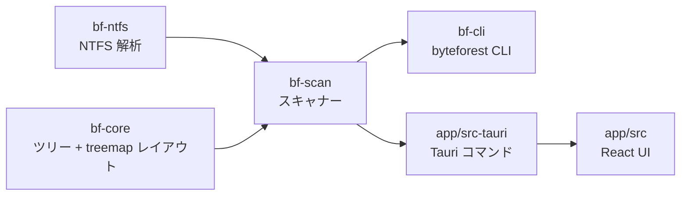

<p align="center">
  
</p>

<h1 align="center">ByteForest</h1>

<p align="center"><b>Windows 向けの高速なオープンソースのディスク使用量アナライザー。ドライブを埋めているものが数秒でわかります。</b></p>

<p align="center"><a href="README.md">English</a> | <a href="README.ru.md">Русский</a> | <a href="README.kk.md">Қазақша</a> | <a href="README.zh-CN.md">简体中文</a> | <a href="README.es.md">Español</a> | <a href="README.de.md">Deutsch</a> | <b>日本語</b></p>

<p align="center">
  <a href="https://github.com/ErnarIT12/byteforest/actions/workflows/ci.yml"></a>
  <a href="https://github.com/ErnarIT12/byteforest/releases"></a>
  <a href="#ライセンス"></a>
  
</p>


*スクリーンショットは、[`scripts/make-demo-data.ps1`](scripts/make-demo-data.ps1) で作成した架空のデモデータです。*

## ByteForest が選ばれる理由

NTFS ボリュームでは、ByteForest はフォルダーごとに Windows へ問い合わせる代わりに、マスターファイルテーブル（MFT）を直接読み取ります。これが数秒と数分の差になります。

| スキャン | モード | エントリ数 | 時間 |
|---|---|---|---|
| Windows 11 PC の `C:` | MFT（レコード単位）、管理者権限 | 約 125 万 | 約 2.2 秒 |
| GitHub Actions ランナー | MFT | 約 120 万ファイル | 11.6 秒 |
| GitHub Actions ランナー | ディレクトリ走査 | 約 120 万ファイル | 541 秒 |

管理者権限がない場合、ByteForest は通常のディレクトリ走査に切り替わり、大幅に遅くなります。これは個別のマシンでの数値であり、正式なベンチマークではありません。`byteforest bench` でご自身の環境を計測できます（[使い方](#使い方)を参照）。

## 機能

- 管理者権限で NTFS ボリュームの **MFT をスキャン**。
- アンチチートドライバーなどで生のボリューム読み取りがブロックされる場合の、**レコード単位のフォールバック**。ファイルシステム経由で MFT を 1 レコードずつ読み取るため、それでも高速です。
- 管理者権限がない場合や NTFS 以外のボリュームでの**ディレクトリ走査フォールバック**。
- サイズ、親に対する割合、ファイル数、更新日を表示する**フォルダーツリー**。
- フォルダーへのズーム、パンくずリスト、ツールチップに対応した **squarified treemap**。
- ツリー、treemap、ステータスバー間の**選択の同期**。
- **「Fast scan (admin)」ボタン**：管理者権限で ByteForest を再起動し、スキャンを自動的に再開します。
- 毎回の起動を高速にする **「Always run as administrator」** 設定。
- **Graphite（ダーク）と Silver（ライト）のテーマ**、またはシステム設定に追従。WCAG AA コントラストに対応。
- フォルダーツリーと treemap の**右クリックメニュー**：開く、エクスプローラー/Finder で表示、パスのコピー、確認後にごみ箱へ移動。ツリー、treemap、合計は再スキャンなしですぐに更新されます。
- 選択したフォルダーの**ファイル種別の内訳**（カテゴリと上位の拡張子）と、treemap の色モード **Folders / File types**。
- よくある容量食い（`node_modules`、`target`、`.venv`、`.git`、ディスクイメージ、1 GB 超のファイル）を**ワンクリックで検索**するプリセット。解放できる合計サイズも表示します。
- ドライブ、デスクトップ、ダウンロード、ドキュメントと、ワンクリックで再スキャンできる最近のスキャンを並べた**サイドバー**。
- **スナップショットと比較**：スキャン結果を小さなファイルに保存し、後のスキャンと比較して、増えたもの、減ったもの、新しいものを確認できます。
- **スキャンの除外**：設定で名前、パターン（`node_modules`、`*.tmp`）、フルパスを除外できます。除外したものはどの合計にも含まれません。
- 表計算ソフトやスクリプト向けに、任意のフォルダーの **CSV / JSON レポート**を出力（**Export report…**）。
- ドライブ一覧、スキャン、スナップショット、除外、レポート、ベンチマークのための**コマンドラインツール**。


## インストール

1. [Releases](https://github.com/ErnarIT12/byteforest/releases) ページを開きます。
2. 次のいずれかをダウンロードします。
   - インストーラー：`ByteForest_<バージョン>_x64-setup.exe`（NSIS）または `ByteForest_<バージョン>_x64_en-US.msi`
   - ポータブルなコマンドラインツール：`byteforest-cli-v<バージョン>-x64.zip`
3. 必要に応じて、同じリリースの `SHA256SUMS.txt` でダウンロードを検証します：`Get-FileHash <ファイル> -Algorithm SHA256`

ビルドは**まだコード署名されていない**ため、Windows SmartScreen が警告を表示します。ダウンロードを信頼できる場合は「詳細情報」を選び、「実行」をクリックしてください。

インストーラーは ByteForest をすべてのユーザー向けに Program Files へインストールします。

動作環境：Windows 10/11 x64 と WebView2（Windows 11 には標準搭載。Windows 10 で未導入の場合はインストーラーがダウンロードします）。

## 使い方

**アプリ。** ドライブを選んで **Scan** を押すか、**Fast scan (admin)** で昇格して再起動し、すぐにスキャンします。ツリーのフォルダーまたは treemap の矩形を選択します（両方は同期します）。treemap でフォルダーをダブルクリックするとズームインし、パンくずリスト、上矢印、マウスホイールで戻れます。

**除外。** 設定（**Excluded from scans**）で、どのフォルダーでも一致する名前やパターン（`node_modules`、`*.tmp`、`$RECYCLE.BIN`）を追加できます。フルパス（`C:\Windows\WinSxS`）はそのフォルダーだけを除外します。ルールは次回のスキャンから有効で、スキャン対象の外にあるパスは無視されます。除外した量はステータスバーに表示されます。

**CLI。**

```text
byteforest drives                    # 利用可能なドライブを一覧表示
byteforest scan C: --top 20          # スキャンして大きい順に 20 件を表示
byteforest scan C: --top 20 --json   # 同じ内容を JSON で出力
byteforest bench C: --runs 3         # スキャンを 3 回計測
byteforest scan C: --save-snapshot before.bfsnap                         # スキャンのスナップショットを保存
byteforest scan C: --diff before.bfsnap                                  # スナップショット以降の変更を表示
byteforest scan C: --exclude node_modules --exclude "C:\Windows\WinSxS"  # 名前とパスを除外
byteforest scan D:\Projects --export report.csv --export-depth 3         # CSV レポートを出力（.json も可）
```

MFT スキャナーを使うには、管理者権限のターミナルから CLI を実行してください。

## ソースからビルド

前提条件：Rust（ツールチェーンは `rust-toolchain.toml` で固定）、MSVC x64 ツールチェーンと Windows SDK を含む Visual Studio Build Tools、Node.js LTS。

```powershell
git clone https://github.com/ErnarIT12/byteforest.git
cd byteforest
npm --prefix app ci
npm --prefix app run tauri build   # インストーラー
cargo test --workspace             # テスト（先にフロントエンドをビルド：npm --prefix app run build）
```

開発の流れと、管理者権限が必要なテストについては [CONTRIBUTING.md](CONTRIBUTING.md) を参照してください。

## アーキテクチャ



- `bf-ntfs`：バイトスライス上の純粋な NTFS パーサー。Windows API は使いません。
- `bf-core`：ツリーモデル、サイズ集計、treemap レイアウト。Windows API は使いません。
- `bf-scan`：`MftScanner` と `WalkScanner`、および自動モード選択。
- `bf-cli`：コマンドラインツール `byteforest`。
- `app`：Tauri シェル（`src-tauri`）と React + TypeScript の UI（`src`）。

スキャンしたツリーは Rust 内に保持されます。UI が要求するのは一部分だけで、1 つのフォルダーの子（最大 1000 ノード）か、1 つの treemap ビューの矩形（最大 20 000）です。

## プライバシー

ByteForest は完全にオフラインで動作します。テレメトリはなく、コードはネットワーク通信を行いません。アプリのウィンドウが通信できるのはローカルの Rust バックエンドだけです（Content Security Policy がそれ以外を許可しません）。設定は `%APPDATA%\ByteForest\settings.json`、ログは `%LOCALAPPDATA%\ByteForest\logs` に保存され、どちらもお使いのマシン上にあります。

## ロードマップ

- 1 エントリあたり 120 バイト以下のメモリ使用量（現在は約 400）。
- treemap と並ぶ Sunburst ビュー。
- Discard Pile：項目を集めてまとめて削除。
- 自動スナップショット。
- NTFS USN ジャーナルによる増分再スキャン。
- UI の多言語化。

## コントリビュート

issue と pull request を歓迎します。まず [CONTRIBUTING.md](CONTRIBUTING.md) と[行動規範](CODE_OF_CONDUCT.md)をお読みください。

## セキュリティ

脆弱性は [SECURITY.md](SECURITY.md) の手順に従って非公開で報告してください。

## ライセンス

次のいずれかのライセンスを選択できます。

- Apache License, Version 2.0 ([LICENSE-APACHE](LICENSE-APACHE))
- MIT ライセンス ([LICENSE-MIT](LICENSE-MIT))

明示的に別段の表明をしない限り、本プロジェクトへの取り込みを目的として提出された貢献は、追加の条件なしに上記のデュアルライセンスとなります。

## 謝辞

WinDirStat、WizTree、[Radix](https://github.com/colinvkim/Radix) などのディスクアナライザーに着想を得ています。
