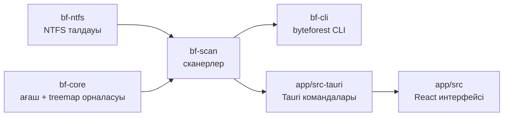

<p align="center">
  
</p>

<h1 align="center">ByteForest</h1>

<p align="center"><b>Windows және macOS жүйелеріне арналған ашық кодты жылдам диск кеңістігі анализаторы.</b></p>

<p align="center"><a href="README.md">English</a> | <a href="README.ru.md">Русский</a> | <b>Қазақша</b> | <a href="README.zh-CN.md">简体中文</a> | <a href="README.es.md">Español</a> | <a href="README.de.md">Deutsch</a> | <a href="README.ja.md">日本語</a></p>

<p align="center">
  <a href="https://github.com/ErnarIT12/byteforest/actions/workflows/ci.yml"></a>
  <a href="https://github.com/ErnarIT12/byteforest/releases"></a>
  <a href="#лицензия"></a>
  
  
</p>

## Алғашқы сканерлеу

1. [ByteForest жүктеп алу](https://github.com/ErnarIT12/ByteForest/releases).
2. Бір қалтаны сканерлеу үшін **Choose folder…**, ал таңдалған дискіні сканерлеу үшін **Scan drive** түймесін басыңыз.
3. Картадағы қалтаны екі рет басып ашыңыз. Жоғары деңгейге оралу үшін картаның үстіндегі жолды пайдаланыңыз.


## Ірі файлдар

Файлдарды түрі немесе көлемі бойынша сүзу үшін **Largest files** бөлімін ашыңыз. Файлдарды белгілеңіз де, себетке жібермес бұрын **Cleanup** бөлімінде жолдарын тексеріңіз.


*Скриншоттар macOS жүйесінде ойдан шығарылған демо-деректермен түсірілді.*

## Жарқыл жылдамдықпен сканерлеу: MFT және қалталарды аралау, қалдыру ережелерімен

NTFS томдарында ByteForest әр қалтаны Windows-тан бір-бірлеп сұрамай, Master File Table (MFT) кестесін тікелей оқиды. Секунд пен минуттың айырмасы осында.

| Сканерлеу | Режим | Жазбалар | Уақыты |
|---|---|---|---|
| Windows 11 ПК-дегі `C:` | MFT (жазбалап), әкімші құқығымен | ~1,25 млн | ~2,2 с |
| GitHub Actions раннері | MFT | ~1,2 млн файл | 11,6 с |
| GitHub Actions раннері | Қалталарды аралап шығу | ~1,2 млн файл | 541 с |

Бұл жеке машиналардағы өлшемдер, ресми бенчмарк емес; өзіңіздікін `byteforest bench` командасымен өлшеңіз ([Қолдану](#қолдану) бөлімін қараңыз).

- NTFS томдарының **MFT сканерлеуі**. Windows және әкімші құқығы қажет.
- Тікелей оқу бұғатталғанда (мысалы, anti-cheat драйверлері) **жазбаларды бір-бірлеп оқитын қосалқы режим**: MFT файл жүйесі арқылы жазба-жазбамен оқылады, бұл да жылдам.
- Әкімші құқығынсыз, NTFS емес томдарда және macOS-та (онда MFT сканері жоқ) **қалталарды аралап шығу**. Үлкен томдарда ол әлдеқайда баяу.
- **«Fast scan (admin)» түймесі** (Windows): ByteForest-ті әкімші құқығымен қайта іске қосып, сканерлеуді өзі жалғастырады. **«Always run as administrator»** параметрі әр іске қосуды жылдам етеді.
- **Сканерлеуден тыс қалдыру**: параметрлерде кез келген қалтада сәйкес келетін атауларды және үлгілерді (`*` пен `?`, мысалы `node_modules` немесе `*.tmp`) не сканерленетін қалтаның ішіндегі абсолютті жолды қалдыруға болады. Қалдырылғандар ешбір қорытындыға кірмейді, ал күй жолында қанша қалдырылғаны көрінеді.
- **Бүкіл сканерлеу бойынша іздеу** (**Largest Files**): атауы, кеңейтуі және ең кіші өлшемі бойынша, сондай-ақ орынды көп алатын әдеттегі нәрселерді (`node_modules`, `target`, `.venv`, `.git`, диск бейнелері, 1 ГБ-тан үлкен файлдар) бір басумен табатын дайын үлгілер, босатуға болатын жалпы өлшемімен.
- Кестелер мен скрипттер үшін кез келген қалтаның **CSV және JSON есептері** (**Export report…**).
- Дисктер, сканерлеу, снапшоттар, қалдыру, есептер және өлшеу үшін **командалық жол құралы**.

## Интерактивті шолу: Treemap және Sunburst

- Өлшемі, ата-аналық қалтадағы үлесі, файлдар саны және өзгерту күні бар **қалталар ағашы**.
- **Squarified treemap** және **Sunburst диск диаграммасы**; карта үстіндегі **Treemap | Sunburst** ауыстырғышымен ауысады. Екеуінде де қалтаға үлкейту, жол сілтемелері (breadcrumbs), қалқымалы кеңестер, пернетақтамен басқару және контекстік мәзір бар.
- Ағашта, картада және күй жолында **үйлесімді таңдау**. Қос басу қалтаны ашады; кері қайту үшін breadcrumbs, жоғары көрсеткі немесе тышқан дөңгелегін қолданыңыз.
- Таңдалған қалта үшін **файл түрлері бойынша бөлу** (санаттар және ең ірі кеңейтулер) және карталардың шартты белгісі бар **Folders / File types** түс режимі.
- Ағашта және карталарда **контекстік мәзір** (тінтуірдің оң жағы, сондай-ақ Shift+F10): ашу, Explorer/Finder-де көрсету, жолды көшіру немесе растаудан кейін Себетке жылжыту. Барлығы қайта сканерлеусіз бірден жаңарады.


## Cleanup, авто-снапшоттар және салыстыру

- **Cleanup (тастау тізімі)**: ағаштан, карталардан немесе инспектордан файлдар мен қалталарды кезекке қоюға болады (Delete пернесі немесе тінтуірдің оң жағы), Cleanup бөлімінде жалпы өлшемді көріп, барлығын бір растаумен Себетке жылжытуға болады. Растамайынша ештеңе жойылмайды, жылжытылмаған элементтер себебімен бірге кезекте қалады.
- **Снапшоттар**: сканерлеуді шағын `.bfsnap` файлына сақтаңыз, кейін жаңа сканерлеуді онымен салыстырып, не өскенін, не азайғанын немесе не жаңа екенін көріңіз. Changes көрінісі ең үлкен өсімдерді тізімдейді.
- **Екі картада да айырмашылықтарды бөлектеу**: салыстыру кезінде өскен, жаңа және кішірейген элементтер treemap пен sunburst-та жиекпен белгіленеді (тұтас, нүктелі және үзік сызық), өлшем өзгерісі жапсырма ретінде көрсетіледі.
- **Автоматты снапшоттар**: аяқталған әр сканерлеу фондық режимде сақталады (әдепкіде соңғы 10; параметрлерде 0-ден 50-ге дейін немесе өшірулі). Кез келгенін бүйір панелінен қайта сканерлемей, тек оқу режимінде лезде ашыңыз немесе ағымдағы сканерлеумен салыстырыңыз.
- **CLI арқылы салыстыру**: `byteforest scan <target> --save-snapshot <FILE>` және `--diff <FILE>` ([Қолдану](#қолдану) бөлімін қараңыз).

## Минимализмге құрылған интерфейс және 100% офлайн құпиялылық

- Radix-тен шабыт алған **минималистік интерфейс** және біртұтас сол жақ бүйір панель: дисктер, Жұмыс үстелі, Жүктемелер және Құжаттар, соңғы сканерлеулер және Cleanup; панель белгішелер жолағына жиылады.
- **Graphite (қараңғы, әдепкі) және Silver (ашық) тақырыптары** немесе жүйе тақырыбын қолдану, WCAG AA контрастымен. Меңзер эффектілері анимацияны азайту параметрін ескереді.
- **Толық офлайн жұмыс.** Телеметрия, тіркелгі және жаңартуды тексеру жоқ, код желіге сұраныс жібермейді. Қолданба терезесі тек жергілікті Rust бэкендімен сөйлесе алады; Content Security Policy басқаға рұқсат бермейді.
- **Деректер сіздің компьютеріңізде қалады.** Параметрлер `%APPDATA%\ByteForest\settings.json` файлында, логтар `%LOCALAPPDATA%\ByteForest\logs` қалтасында сақталады. Автоматты снапшоттар (сканерленген элементтердің атаулары мен өлшемдері) `%LOCALAPPDATA%\dev.byteforest.app\snapshots\auto` (macOS-та `~/Library/Application Support/dev.byteforest.app/snapshots/auto`) қалтасында сақталады және Параметрлерде өшіруге немесе санын шектеуге болады.

## Орнату

1. [Releases](https://github.com/ErnarIT12/byteforest/releases) бетін ашыңыз.
2. Мыналардың бірін жүктеңіз:
   - орнатушы: `ByteForest_<нұсқа>_x64-setup.exe` (NSIS) немесе `ByteForest_<нұсқа>_x64_en-US.msi`;
   - портативті командалық жол құралы: `byteforest-cli-v<нұсқа>-x64.zip`.
3. Қаласаңыз, жүктелгенді сол релиздегі `SHA256SUMS.txt` файлымен салыстырыңыз: `Get-FileHash <файл> -Algorithm SHA256`.

Құрастырулар **әлі қол қойылмаған**, сондықтан Windows SmartScreen ескерту көрсетеді. Жүктелгенге сенсеңіз, «Қосымша ақпарат», содан кейін «Бәрібір орындау» таңдаңыз.

Орнатушы ByteForest-ті барлық пайдаланушыларға, Program Files қалтасына орнатады.

Талаптар: Windows 10/11 x64 және WebView2 (Windows 11-де алдын ала орнатылған; Windows 10-да орнатушы қажет болса жүктейді).

### macOS беталы нұсқасы

Әмбебап DMG файлын [GitHub Releases](https://github.com/ErnarIT12/byteforest/releases) бетінен жүктеп, SHA256SUMS.txt файлымен салыстырыңыз да, ByteForest-ті «Қолданбалар» қалтасына сүйреңіз. Бета нұсқа macOS 15 немесе одан жаңасын қажет етеді, Apple Silicon және Intel процессорларын қолдайды. Қолданбаға ad hoc қолтаңба қойылған. Оған Apple нотариалдық растауы жоқ болғандықтан, Gatekeeper алғашқы іске қосуды «Құпиялылық және қауіпсіздік» бөлімінде растауды сұрауы мүмкін. [Apple-дің алғашқы іске қосу нұсқаулығы](https://support.apple.com/en-us/102445)

ByteForest үй қалтасын, Mac деректер томын, жергілікті қосылған дисктерді және жүйелік қалта таңдау терезесін ұсынады. Ол қалталарды ағымдағы пайдаланушы құқығымен аралайды. Өткізіп жіберілген элементтер күй жолында көрсетіледі. Бөлінген өлшемдер болжам болып табылады. APFS клондары, ортақ блоктар және снапшоттар сканерлеу қорытындыларының том пайдалануынан өзгешелігіне әкелуі мүмкін.

## Қолдану

Сканерлегеннен кейін **Largest Files** бөлімін ашып, барлық сканерленген қалталардағы файлдарды атауы, кеңейтуі немесе өлшемі бойынша іздеңіз. Нәтижені таңдасаңыз, ол ағаш пен картада ашылады. Файлды немесе қалтаны таңдап, оның жолын көшіруге немесе Explorer/Finder-де көрсетуге болады.

**Қолданба.** Дискіні таңдап, **Scan** түймесін басыңыз немесе **Fast scan (admin)** арқылы жоғары құқықпен қайта іске қосып, бірден сканерлеңіз. Ағаштағы қалталарды немесе treemap тіктөртбұрыштарын таңдаңыз (таңдау екеуінде де үйлесіп тұрады). Treemap-тағы қалтаны екі рет басу оны үлкейтеді; кері қайту үшін breadcrumbs, жоғары көрсеткі немесе тышқан дөңгелегін қолданыңыз.

**Қалдыру.** Параметрлерде (**Excluded from scans**) кез келген қалтада сәйкес келетін атауларды немесе үлгілерді (`node_modules`, `*.tmp`, `$RECYCLE.BIN`) қосыңыз. Толық жол (`C:\Windows\WinSxS`) тек сол қалтаны қалдырады. Ережелер келесі сканерлеуден бастап қолданылады; сканерленетін орыннан тыс жолдар еленбейді. Күй жолында қанша қалдырылғаны көрсетіледі.

**CLI.**

```text
byteforest drives                    # қолжетімді дисктер тізімі
byteforest scan C: --top 20          # сканерлеп, ең үлкен 20 элементті шығару
byteforest scan C: --top 20 --json   # солай, JSON түрінде
byteforest bench C: --runs 3         # сканерлеуді үш рет өлшеу
byteforest scan C: --save-snapshot before.bfsnap                         # сканерлеу снапшотын сақтау
byteforest scan C: --diff before.bfsnap                                  # снапшоттан бері не өзгергенін көрсету
byteforest scan C: --exclude node_modules --exclude "C:\Windows\WinSxS"  # атауларды және жолдарды өткізіп жіберу
byteforest scan D:\Projects --export report.csv --export-depth 3         # CSV есебін жазу (.json да болады)
```

MFT сканерін қолдану үшін CLI-ды әкімші құқығымен ашылған терминалдан іске қосыңыз.

## Бастапқы кодтан құрастыру

Қажет: Rust (тулчейн `rust-toolchain.toml` файлында бекітілген), MSVC x64 және Windows SDK бар Visual Studio Build Tools, Node.js LTS.

```powershell
git clone https://github.com/ErnarIT12/byteforest.git
cd byteforest
npm --prefix app ci
npm --prefix app run tauri build   # орнатушылар
cargo test --workspace             # тесттер (алдымен фронтендті құрастырыңыз: npm --prefix app run build)
```

Жұмыс барысы мен әкімші құқығын қажет ететін тесттер [CONTRIBUTING.md](CONTRIBUTING.md) файлында сипатталған.

macOS-та Xcode Command Line Tools және екі Rust мақсатын орнатып, `npm --prefix app run tauri build -- --target universal-apple-darwin --bundles dmg` командасымен құрастырыңыз. [Tauri DMG нұсқаулығын](https://v2.tauri.app/distribute/dmg/) қараңыз.

## Архитектура



- `bf-ntfs`: байт кесінділері бойынша таза NTFS талдауы, Windows API жоқ.
- `bf-core`: ағаш моделі, өлшем агрегаттары және treemap орналасуы, Windows API жоқ.
- `bf-scan`: `MftScanner` және `WalkScanner`, режимді автоматты таңдау.
- `bf-cli`: `byteforest` командалық жол құралы.
- `app`: Tauri қабығы (`src-tauri`) және React + TypeScript интерфейсі (`src`).

Сканерленген ағаш Rust ішінде қалады. Интерфейс тек кесінділерді сұрайды: бір қалтаның балаларын (ең көбі 1000 түйін) немесе бір treemap көрінісінің тіктөртбұрыштарын (ең көбі 20 000).

## Жоспарлар

- Бір жазбаға 120 байт немесе одан аз жады (қазір шамамен 400).
- NTFS USN журналы бойынша инкрементті қайта сканерлеу.
- Локализацияланған интерфейс.

## Үлес қосу

Issues және pull request қабылданады. Алдымен [CONTRIBUTING.md](CONTRIBUTING.md) және [Мінез-құлық кодексін](CODE_OF_CONDUCT.md) оқыңыз.

## Қауіпсіздік

Осалдықтар туралы [SECURITY.md](SECURITY.md) файлында сипатталғандай жеке түрде хабарлаңыз.

## Лицензия

Сіздің таңдауыңыз бойынша мына лицензиялардың бірімен беріледі:

- Apache License, Version 2.0 ([LICENSE-APACHE](LICENSE-APACHE))
- MIT лицензиясы ([LICENSE-MIT](LICENSE-MIT))

Өзге жағдай нақты көрсетілмесе, жобаға енгізу үшін әдейі жіберілген кез келген үлес жоғарыдағыдай қосарлы лицензияланады, қосымша шарттарсыз.

## Алғыс

WinDirStat және WizTree сияқты диск анализаторларынан шабыт алды. Минималистік интерфейс UX жағынан [Radix](https://github.com/colinvkim/Radix) (MIT) жобасынан шабыт алған; Radix коды қолданылмайды. Белгішелер [Lucide](https://lucide.dev) (ISC) жинағынан.
