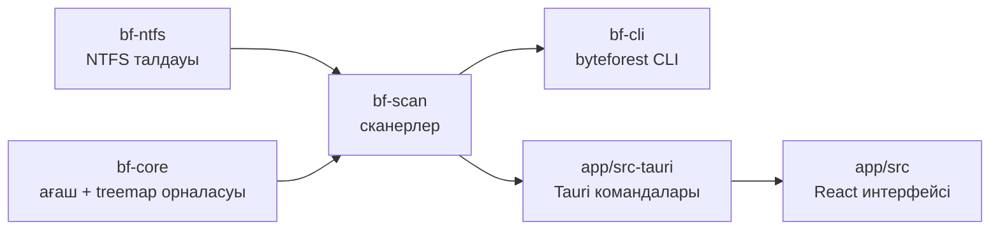

<p align="center">
  
</p>

<h1 align="center">ByteForest</h1>

<p align="center"><b>Windows үшін жылдам open-source диск орны анализаторы: дискіні не толтырып тұрғанын секундтар ішінде көріңіз.</b></p>

<p align="center"><a href="README.md">English</a> | <a href="README.ru.md">Русский</a> | <b>Қазақша</b> | <a href="README.zh-CN.md">简体中文</a> | <a href="README.es.md">Español</a> | <a href="README.de.md">Deutsch</a> | <a href="README.ja.md">日本語</a></p>

<p align="center">
  <a href="https://github.com/ErnarIT12/byteforest/actions/workflows/ci.yml"></a>
  <a href="https://github.com/ErnarIT12/byteforest/releases"></a>
  <a href="#лицензия"></a>
  
</p>


*Скриншоттарда [`scripts/make-demo-data.ps1`](scripts/make-demo-data.ps1) скрипті жасаған ойдан шығарылған демо-деректер көрсетілген.*

## Неге ByteForest

NTFS томдарында ByteForest әр қалтаны Windows-тан бір-бірлеп сұрамай, Master File Table (MFT) кестесін тікелей оқиды. Секунд пен минуттың айырмасы осында.

| Сканерлеу | Режим | Жазбалар | Уақыты |
|---|---|---|---|
| Windows 11 ПК-дегі `C:` | MFT, әкімші құқығымен | ~1,25 млн | ~2,2 с |
| GitHub Actions раннері | MFT | ~1,2 млн файл | 11,6 с |
| GitHub Actions раннері | Қалталарды аралап шығу | ~1,2 млн файл | 541 с |

Әкімші құқығынсыз ByteForest қарапайым қалталарды аралап шығуға көшеді, ол әлдеқайда баяу. Бұл жеке машиналардағы өлшемдер, ресми бенчмарк емес; өзіңіздікін `byteforest bench` командасымен өлшеңіз ([Қолдану](#қолдану) бөлімін қараңыз).

## Мүмкіндіктер

- Әкімші құқығымен NTFS томдарының **MFT сканерлеуі**.
- Тікелей оқу бұғатталғанда (мысалы, anti-cheat драйверлері) **жазбаларды бір-бірлеп оқитын қосалқы режим**: MFT файл жүйесі арқылы жазба-жазбамен оқылады, бұл да жылдам.
- Әкімші құқығынсыз немесе NTFS емес томдарда **қалталарды аралап шығатын қосалқы режим**.
- Өлшемі, ата-ана қалтадағы үлесі, файлдар саны және өзгерту күні бар **қалталар ағашы**.
- Қалтаға үлкейту, жол сілтемелері (breadcrumbs) және қалқымалы кеңестері бар **squarified treemap**.
- Ағашта, treemap-та және күй жолында **үйлесімді таңдау**.
- **«⚡ Fast scan (admin)» түймесі**: ByteForest-ты әкімші құқығымен қайта іске қосып, сканерлеуді өзі жалғастырады.
- Әр іске қосу жылдам болуы үшін **«Always run as administrator»** параметрі.
- Логотип палитрасындағы, WCAG AA контрастты **ашық және қараңғы тақырып**.
- Дисктер, сканерлеу және өлшеу үшін **командалық жол құралы**.


## Орнату

1. [Releases](https://github.com/ErnarIT12/byteforest/releases) бетін ашыңыз.
2. Мыналардың бірін жүктеңіз:
   - орнатушы: `ByteForest_<нұсқа>_x64-setup.exe` (NSIS) немесе `ByteForest_<нұсқа>_x64_en-US.msi`;
   - портативті командалық жол құралы: `byteforest-cli-v<нұсқа>-x64.zip`.
3. Қаласаңыз, жүктелгенді сол релиздегі `SHA256SUMS.txt` файлымен салыстырыңыз: `Get-FileHash <файл> -Algorithm SHA256`.

Құрастырулар **әлі қол қойылмаған**, сондықтан Windows SmartScreen ескерту көрсетеді. Жүктелгенге сенсеңіз, «Қосымша ақпарат», содан кейін «Бәрібір орындау» таңдаңыз.

Талаптар: Windows 10/11 x64 және WebView2 (Windows 11-де алдын ала орнатылған; Windows 10-да орнатушы қажет болса жүктейді).

## Қолдану

**Қолданба.** Дискіні таңдап, **Scan** түймесін басыңыз немесе **⚡ Fast scan (admin)** арқылы жоғары құқықпен қайта іске қосып, бірден сканерлеңіз. Ағаштағы қалталарды немесе treemap тіктөртбұрыштарын таңдаңыз (таңдау екеуінде де үйлесіп тұрады). Treemap-тағы қалтаны басу оны үлкейтеді; кері қайту үшін breadcrumbs, жоғары көрсеткі немесе тышқан дөңгелегін қолданыңыз.

**CLI.**

```text
byteforest drives                    # қолжетімді дисктер тізімі
byteforest scan C: --top 20          # сканерлеп, ең үлкен 20 элементті шығару
byteforest scan C: --top 20 --json   # солай, JSON түрінде
byteforest bench C: --runs 3         # сканерлеуді үш рет өлшеу
```

MFT сканерін қолдану үшін CLI-ды әкімші құқығымен ашылған терминалдан іске қосыңыз.

## Бастапқы кодтан құрастыру

Қажет: Rust (тулчейн `rust-toolchain.toml` файлында бекітілген), MSVC x64 және Windows SDK бар Visual Studio Build Tools, Node.js LTS.

```powershell
git clone https://github.com/ErnarIT12/byteforest.git
cd byteforest
npm --prefix app ci
npm --prefix app run tauri build   # орнатушылар
cargo test --workspace             # тесттер (алдымен фронтендті құрастырыңыз: npm --prefix app run build)
```

Жұмыс барысы мен әкімші құқығын қажет ететін тесттер [CONTRIBUTING.md](CONTRIBUTING.md) файлында сипатталған.

## Архитектура



- `bf-ntfs`: байт кесінділері бойынша таза NTFS талдауы, Windows API жоқ.
- `bf-core`: ағаш моделі, өлшем агрегаттары және treemap орналасуы, Windows API жоқ.
- `bf-scan`: `MftScanner` және `WalkScanner`, режимді автоматты таңдау.
- `bf-cli`: `byteforest` командалық жол құралы.
- `app`: Tauri қабығы (`src-tauri`) және React + TypeScript интерфейсі (`src`).

Сканерленген ағаш Rust ішінде қалады. Интерфейс тек кесінділерді сұрайды: бір қалтаның балаларын (ең көбі 1000 түйін) немесе бір treemap көрінісінің тіктөртбұрыштарын (ең көбі 20 000).

## Құпиялылық

ByteForest толық офлайн жұмыс істейді. Онда телеметрия жоқ, коды желіге қоңырау шалмайды; қолданба терезесі тек жергілікті Rust бэкендімен сөйлесе алады (Content Security Policy басқаға рұқсат бермейді). Параметрлер `%APPDATA%\ByteForest\settings.json` файлында, логтар `%LOCALAPPDATA%\ByteForest\logs` қалтасында сақталады, екеуі де сіздің компьютеріңізде.

## Жоспарлар

- Бір жазбаға 120 байт немесе одан аз жады (қазір шамамен 400).
- Іздеу және сұрыптау.
- Мәліметтер панелі.
- Себетке жылжыту.
- Локализацияланған интерфейс.

## Үлес қосу

Issues және pull request қабылданады. Алдымен [CONTRIBUTING.md](CONTRIBUTING.md) және [Мінез-құлық кодексін](CODE_OF_CONDUCT.md) оқыңыз.

## Қауіпсіздік

Осалдықтар туралы [SECURITY.md](SECURITY.md) файлында сипатталғандай жеке түрде хабарлаңыз.

## Лицензия

Сіздің таңдауыңыз бойынша мына лицензиялардың бірімен беріледі:

- Apache License, Version 2.0 ([LICENSE-APACHE](LICENSE-APACHE))
- MIT лицензиясы ([LICENSE-MIT](LICENSE-MIT))

Өзге жағдай нақты көрсетілмесе, жобаға енгізу үшін әдейі жіберілген кез келген үлес жоғарыдағыдай қосарлы лицензияланады, қосымша шарттарсыз.

## Алғыс

WinDirStat және WizTree сияқты диск анализаторларынан шабыт алды.
