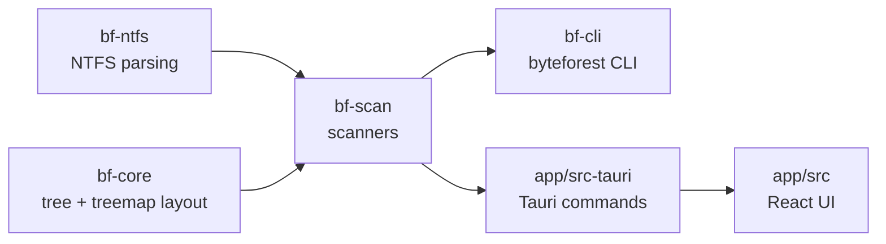

<p align="center">
  
</p>

<h1 align="center">ByteForest</h1>

<p align="center"><b>A fast, open-source disk space analyzer for Windows and macOS.</b></p>

<p align="center"><b>English</b> | <a href="README.ru.md">Русский</a> | <a href="README.kk.md">Қазақша</a> | <a href="README.zh-CN.md">简体中文</a> | <a href="README.es.md">Español</a> | <a href="README.de.md">Deutsch</a> | <a href="README.ja.md">日本語</a></p>

<p align="center">
  <a href="https://github.com/ErnarIT12/byteforest/actions/workflows/ci.yml"></a>
  <a href="https://github.com/ErnarIT12/byteforest/releases"></a>
  <a href="#license"></a>
  
  
</p>


*Captured on macOS with fictional demo data.*

## Blazing-fast scanning: MFT and directory walk, with exclusions

On NTFS volumes ByteForest reads the Master File Table (MFT) directly instead of asking Windows about every folder one by one. That is the difference between seconds and minutes.

| Scan | Mode | Entries | Time |
|---|---|---|---|
| `C:` on a Windows 11 PC | MFT (record-by-record), with admin rights | ~1.25 million | ~2.2 s |
| GitHub Actions runner | MFT | ~1.2 million files | 11.6 s |
| GitHub Actions runner | Directory walk | ~1.2 million files | 541 s |

These are single-machine numbers, not a formal benchmark; measure your own with `byteforest bench` (see [Usage](#usage)).

- **MFT scan** of NTFS volumes. It needs Windows and administrator rights.
- **Record-by-record fallback** when raw volume reads are blocked (for example by anti-cheat drivers): the MFT is read one record at a time through the file system, which is still fast.
- **Directory walk** without administrator rights, on non-NTFS volumes, and always on macOS, where there is no MFT scan. It is much slower on large volumes.
- **"Fast scan (admin)" button** (Windows): restarts ByteForest with administrator rights and resumes the scan automatically. The **"Always run as administrator"** setting makes every start fast.
- **Scan exclusions**: in Settings, leave out names and wildcards (`*` and `?`, such as `node_modules` or `*.tmp`) that match in any folder, or an absolute path under the scan root. Excluded items are not counted in any total, and the status bar shows how much was left out.
- **Search the whole scan** in **Largest Files** by name, extension and minimum size, or use one-click presets for common space hogs (`node_modules`, `target`, `.venv`, `.git`, disk images, files over 1 GB) that show the total size you could reclaim.
- **CSV and JSON reports** of any folder for spreadsheets and scripts (**Export report…**).
- **Command-line tool** for drives, scans, snapshots, exclusions, reports and benchmarks.

## Interactive Treemap and Sunburst exploration

- **Folder tree** with size, share of parent, file count and modification date.
- **Squarified treemap** and a **Sunburst disk chart**, switched with **Treemap | Sunburst** in the top bar. Both support zoom into a folder, breadcrumbs, tooltips, keyboard navigation and the context menu.
- **Synchronized selection** between the tree, the map and the status bar. A double click opens a folder; the breadcrumbs, the up arrow or the mouse wheel zoom back out.
- **File-type breakdown** of the selected folder (categories and top extensions) and a **Folders / File types** color mode for the maps, with a legend.
- **Right-click context menu** (also Shift+F10) on the tree and the maps: open, show in Explorer/Finder, copy the path, or move to the Recycle Bin/Trash after confirmation. Everything updates instantly, without a rescan.


## Discard Pile, auto-snapshots and diff

- **Discard Pile**: queue files and folders from the tree, the maps or the inspector (Delete key or right-click), review the running total in the sidebar, then move everything to the Recycle Bin/Trash in one confirmed step. Nothing is deleted until you confirm, and items that cannot be moved stay queued with the reason.
- **Snapshots**: save a scan to a small `.bfsnap` file and compare a later scan with it to see what grew, shrank or is new. A Changes view lists the biggest increases.
- **Diff highlights on both maps**: while comparing, grown, new and shrunk items are outlined in the treemap and the sunburst (solid, dotted and dashed, with the size change as a label).
- **Automatic snapshots**: every finished scan is saved in the background (the last 10 are kept by default; 0 to 50 or Off in Settings). Reopen one from the sidebar instantly and read-only, without rescanning, or compare it with the current scan.
- **CLI diffs**: `byteforest scan <target> --save-snapshot <FILE>` and `--diff <FILE>` (see [Usage](#usage)).

## Minimalist UI and 100% offline privacy

- **Radix-inspired, minimalist interface** with a unified left sidebar: your drives, Desktop, Downloads and Documents, recent scans and the Discard Pile, collapsing to an icon rail.
- **Graphite (dark, the default) and Silver (light) themes**, or follow the system, with WCAG AA contrast. Hover effects respect the reduced-motion setting.
- **Works fully offline.** There is no telemetry, no account and no update check, and the code makes no network requests. The app window may only talk to the local Rust backend; the Content Security Policy allows nothing else.
- **Your data stays on your machine.** Settings are stored in `%APPDATA%\ByteForest\settings.json` and logs in `%LOCALAPPDATA%\ByteForest\logs`. Automatic snapshots (names and sizes of scanned items) are stored in `%LOCALAPPDATA%\dev.byteforest.app\snapshots\auto` (`~/Library/Application Support/dev.byteforest.app/snapshots/auto` on macOS) and can be turned off or limited in Settings.

## Install

1. Open the [Releases](https://github.com/ErnarIT12/byteforest/releases) page.
2. Download one of:
   - the installer: `ByteForest_<version>_x64-setup.exe` (NSIS) or `ByteForest_<version>_x64_en-US.msi`;
   - the portable command-line tool: `byteforest-cli-v<version>-x64.zip`.
3. Optionally verify the download against `SHA256SUMS.txt` from the same release: `Get-FileHash <file> -Algorithm SHA256`.

Builds are **not code-signed yet**, so Windows SmartScreen shows a warning. Choose "More info", then "Run anyway" if you trust the download.

The installer installs ByteForest for all users, into Program Files.

Requirements: Windows 10/11 x64 and WebView2 (preinstalled on Windows 11; the installer can fetch it on Windows 10 if missing).

### macOS beta

Download the universal DMG from [GitHub Releases](https://github.com/ErnarIT12/byteforest/releases), verify it against SHA256SUMS.txt, then drag ByteForest to Applications. The beta requires macOS 15 or later and supports both Apple Silicon and Intel. The app is ad hoc signed. Since it has no Apple notarization, Gatekeeper may ask you to approve the first launch in Privacy & Security. [Apple’s first-launch instructions](https://support.apple.com/en-us/102445)

ByteForest offers your home folder, the Mac data volume, locally mounted disks, and a native folder picker. It walks directories with the permissions of the current user. Skipped entries are reported in the status bar. Allocated sizes are estimates. APFS clones, shared blocks, and snapshots can make the scan totals differ from volume usage.

## Usage

After scanning, open **Largest Files** to search by name, extension, or size across all scanned folders. Choose a result to jump to it in the tree and map. Select a file or folder to copy its path or reveal it in Explorer or Finder.

**App.** Pick a drive and press **Scan**, or press **Fast scan (admin)** to restart elevated and scan right away. Select folders in the tree or rectangles in the treemap (both stay in sync). Double-click a folder in the treemap to zoom into it; use the breadcrumbs, the up arrow or the mouse wheel to zoom back out.

**Exclusions.** In Settings (**Excluded from scans**), add names or wildcards (`node_modules`, `*.tmp`, `$RECYCLE.BIN`) that match in any folder. A full path (`C:\Windows\WinSxS`) excludes only that folder. Rules apply from the next scan; paths outside the scanned location are ignored. The status bar shows how much was left out.

**CLI.**

```text
byteforest drives                    # list available drives
byteforest scan C: --top 20          # scan and print the 20 largest items
byteforest scan C: --top 20 --json   # same, as JSON
byteforest bench C: --runs 3         # time the scan three times
byteforest scan C: --save-snapshot before.bfsnap                         # save a snapshot of the scan
byteforest scan C: --diff before.bfsnap                                  # show what changed since the snapshot
byteforest scan C: --exclude node_modules --exclude "C:\Windows\WinSxS"  # skip names and paths
byteforest scan D:\Projects --export report.csv --export-depth 3         # write a CSV report (.json also works)
```

Run the CLI from an elevated terminal to use the MFT scanner.

## Build from source

Prerequisites: Rust (the toolchain is pinned in `rust-toolchain.toml`), Visual Studio Build Tools with the MSVC x64 toolchain and a Windows SDK, and Node.js LTS.

```powershell
git clone https://github.com/ErnarIT12/byteforest.git
cd byteforest
npm --prefix app ci
npm --prefix app run tauri build   # installers
cargo test --workspace             # tests (build the frontend first: npm --prefix app run build)
```

See [CONTRIBUTING.md](CONTRIBUTING.md) for the development workflow and the admin-only tests.

On macOS, install Xcode Command Line Tools and both Rust targets, then build with `npm --prefix app run tauri build -- --target universal-apple-darwin --bundles dmg`. See the [Tauri DMG guide](https://v2.tauri.app/distribute/dmg/).

## Architecture



- `bf-ntfs`: pure NTFS parsing over byte slices, no Windows APIs.
- `bf-core`: tree model, size aggregates and treemap layout, no Windows APIs.
- `bf-scan`: `MftScanner` and `WalkScanner`, plus automatic mode selection.
- `bf-cli`: the `byteforest` command-line tool.
- `app`: Tauri shell (`src-tauri`) and React + TypeScript interface (`src`).

The scanned tree stays in Rust. The UI only asks for slices: the children of one folder (at most 1000 nodes) or the rectangles of one treemap view (at most 20 000).

## Roadmap

- Memory use of 120 bytes per entry or less (today about 400).
- Incremental rescans from the NTFS USN journal.
- Localized interface.

## Contributing

Issues and pull requests are welcome. Please read [CONTRIBUTING.md](CONTRIBUTING.md) and the [Code of Conduct](CODE_OF_CONDUCT.md) first.

## Security

Please report vulnerabilities privately, as described in [SECURITY.md](SECURITY.md).

## License

Licensed under either of

- Apache License, Version 2.0 ([LICENSE-APACHE](LICENSE-APACHE))
- MIT license ([LICENSE-MIT](LICENSE-MIT))

at your option. Unless you explicitly state otherwise, any contribution intentionally submitted for inclusion in the work shall be dual licensed as above, without any additional terms or conditions.

## Acknowledgements

Inspired by disk analyzers such as WinDirStat and WizTree. The minimalist interface takes its UX inspiration from [Radix](https://github.com/colinvkim/Radix) (MIT); no Radix code is used. Icons are from [Lucide](https://lucide.dev) (ISC).
