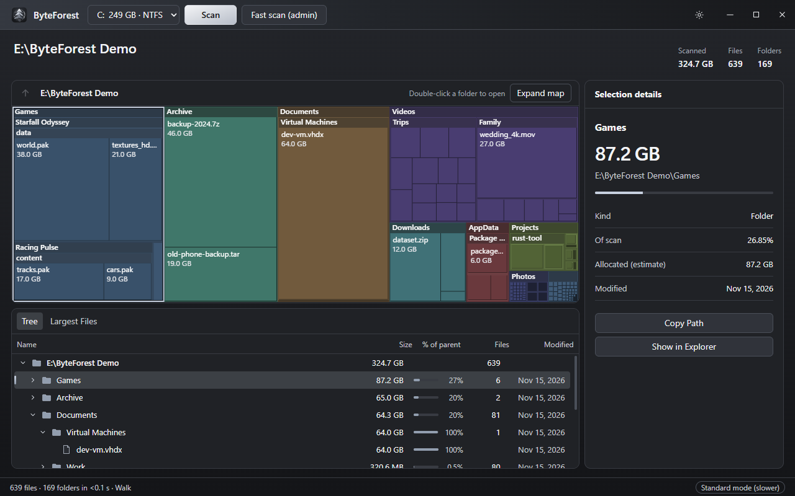
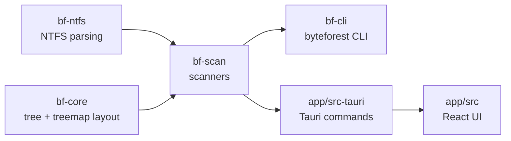

<p align="center">
  
</p>

<h1 align="center">ByteForest</h1>

<p align="center"><b>A fast, open-source disk space analyzer for Windows: see what fills your drive in seconds.</b></p>

<p align="center"><b>English</b> | <a href="README.ru.md">Русский</a> | <a href="README.kk.md">Қазақша</a> | <a href="README.zh-CN.md">简体中文</a> | <a href="README.es.md">Español</a> | <a href="README.de.md">Deutsch</a> | <a href="README.ja.md">日本語</a></p>

<p align="center">
  <a href="https://github.com/ErnarIT12/byteforest/actions/workflows/ci.yml"></a>
  <a href="https://github.com/ErnarIT12/byteforest/releases"></a>
  <a href="#license"></a>
  
</p>



*The screenshots show fictional demo data created by [`scripts/make-demo-data.ps1`](scripts/make-demo-data.ps1).*

## Why ByteForest

On NTFS volumes ByteForest reads the Master File Table (MFT) directly instead of asking Windows about every folder one by one. That is the difference between seconds and minutes.

| Scan | Mode | Entries | Time |
|---|---|---|---|
| `C:` on a Windows 11 PC | MFT (record-by-record), with admin rights | ~1.25 million | ~2.2 s |
| GitHub Actions runner | MFT | ~1.2 million files | 11.6 s |
| GitHub Actions runner | Directory walk | ~1.2 million files | 541 s |

Without administrator rights ByteForest falls back to a regular directory walk, which is much slower. These are single-machine numbers, not a formal benchmark; measure your own with `byteforest bench` (see [Usage](#usage)).

## Features

- **MFT scan** of NTFS volumes with administrator rights.
- **Record-by-record fallback** when raw volume reads are blocked (for example by anti-cheat drivers): the MFT is read one record at a time through the file system, which is still fast.
- **Directory walker fallback** without admin rights or on non-NTFS volumes.
- **Folder tree** with size, share of parent, file count and modification date.
- **Squarified treemap** with zoom into a folder, breadcrumbs and tooltips.
- **Synchronized selection** between the tree, the treemap and the status bar.
- **"Fast scan (admin)" button**: restarts ByteForest with administrator rights and resumes the scan automatically.
- **"Always run as administrator"** setting, so every start is fast.
- **Graphite (dark) and Silver (light) themes**, or follow the system, with WCAG AA contrast.
- **Command-line tool** for drives, scans and benchmarks.


## Install

1. Open the [Releases](https://github.com/ErnarIT12/byteforest/releases) page.
2. Download one of:
   - the installer: `ByteForest_<version>_x64-setup.exe` (NSIS) or `ByteForest_<version>_x64_en-US.msi`;
   - the portable command-line tool: `byteforest-cli-v<version>-x64.zip`.
3. Optionally verify the download against `SHA256SUMS.txt` from the same release: `Get-FileHash <file> -Algorithm SHA256`.

Builds are **not code-signed yet**, so Windows SmartScreen shows a warning. Choose "More info", then "Run anyway" if you trust the download.

The installer installs ByteForest for all users, into Program Files.

Requirements: Windows 10/11 x64 and WebView2 (preinstalled on Windows 11; the installer can fetch it on Windows 10 if missing).


### macOS beta

Download the universal DMG from [GitHub Releases](https://github.com/ErnarIT12/byteforest/releases), verify it against SHA256SUMS.txt, then drag ByteForest to Applications. The beta requires macOS 15 or later and supports both Apple Silicon and Intel. The app is ad hoc signed. Since it has no Apple notarization, Gatekeeper may ask you to approve the first launch in Privacy & Security. [Apple’s first-launch instructions](https://support.apple.com/en-us/102445)

ByteForest offers your home folder, the Mac data volume, locally mounted disks, and a native folder picker. It walks directories with the permissions of the current user. Skipped entries are reported in the status bar. Allocated sizes are estimates. APFS clones, shared blocks, and snapshots can make the scan totals differ from volume usage.

## Usage

After scanning, open **Largest Files** to search by name, extension, or size across all scanned folders. Choose a result to jump to it in the tree and map. Select a file or folder to copy its path or reveal it in Explorer or Finder.

**App.** Pick a drive and press **Scan**, or press **Fast scan (admin)** to restart elevated and scan right away. Select folders in the tree or rectangles in the treemap (both stay in sync). Double-click a folder in the treemap to zoom into it; use the breadcrumbs, the up arrow or the mouse wheel to zoom back out.

**CLI.**

```text
byteforest drives                    # list available drives
byteforest scan C: --top 20          # scan and print the 20 largest items
byteforest scan C: --top 20 --json   # same, as JSON
byteforest bench C: --runs 3         # time the scan three times
```

Run the CLI from an elevated terminal to use the MFT scanner.

## Build from source

Prerequisites: Rust (the toolchain is pinned in `rust-toolchain.toml`), Visual Studio Build Tools with the MSVC x64 toolchain and a Windows SDK, and Node.js LTS.

```powershell
git clone https://github.com/ErnarIT12/byteforest.git
cd byteforest
npm --prefix app ci
npm --prefix app run tauri build   # installers
cargo test --workspace             # tests (build the frontend first: npm --prefix app run build)
```

See [CONTRIBUTING.md](CONTRIBUTING.md) for the development workflow and the admin-only tests.

On macOS, install Xcode Command Line Tools and both Rust targets, then build with npm --prefix app run tauri build -- --target universal-apple-darwin --bundles dmg. See the [Tauri DMG guide](https://v2.tauri.app/distribute/dmg/).

## Architecture



- `bf-ntfs`: pure NTFS parsing over byte slices, no Windows APIs.
- `bf-core`: tree model, size aggregates and treemap layout, no Windows APIs.
- `bf-scan`: `MftScanner` and `WalkScanner`, plus automatic mode selection.
- `bf-cli`: the `byteforest` command-line tool.
- `app`: Tauri shell (`src-tauri`) and React + TypeScript interface (`src`).

The scanned tree stays in Rust. The UI only asks for slices: the children of one folder (at most 1000 nodes) or the rectangles of one treemap view (at most 20 000).

## Privacy

ByteForest works fully offline. It has no telemetry and its code makes no network calls; the app window may only talk to the local Rust backend (the Content Security Policy allows nothing else). Settings are stored in `%APPDATA%\ByteForest\settings.json` and logs in `%LOCALAPPDATA%\ByteForest\logs`, both on your machine.

## Roadmap

- Memory use of 120 bytes per entry or less (today about 400).
- Search and sorting.
- Details panel.
- Move to Recycle Bin.
- Localized interface.

## Contributing

Issues and pull requests are welcome. Please read [CONTRIBUTING.md](CONTRIBUTING.md) and the [Code of Conduct](CODE_OF_CONDUCT.md) first.

## Security

Please report vulnerabilities privately, as described in [SECURITY.md](SECURITY.md).

## License

Licensed under either of

- Apache License, Version 2.0 ([LICENSE-APACHE](LICENSE-APACHE))
- MIT license ([LICENSE-MIT](LICENSE-MIT))

at your option. Unless you explicitly state otherwise, any contribution intentionally submitted for inclusion in the work shall be dual licensed as above, without any additional terms or conditions.

## Acknowledgements

Inspired by disk analyzers such as WinDirStat and WizTree.
