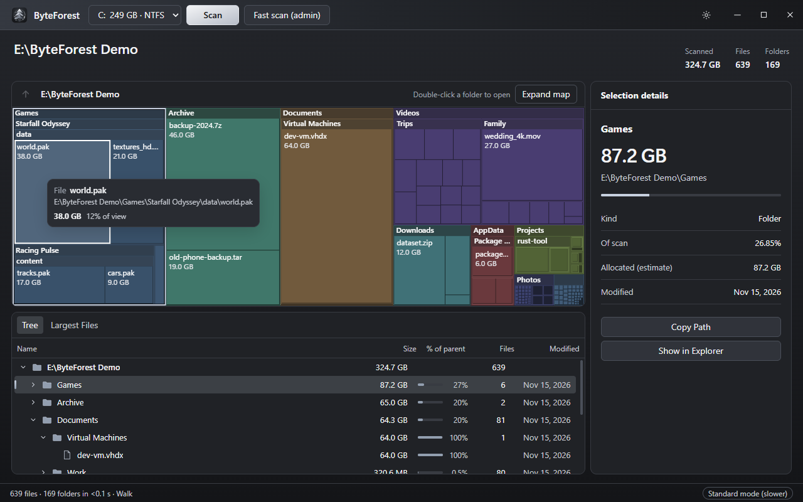
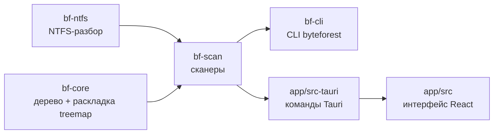

<p align="center">
  
</p>

<h1 align="center">ByteForest</h1>

<p align="center"><b>Быстрый open-source анализатор занятого места на диске для Windows: за секунды видно, что заполняет диск.</b></p>

<p align="center"><a href="README.md">English</a> | <b>Русский</b> | <a href="README.kk.md">Қазақша</a> | <a href="README.zh-CN.md">简体中文</a> | <a href="README.es.md">Español</a> | <a href="README.de.md">Deutsch</a> | <a href="README.ja.md">日本語</a></p>

<p align="center">
  <a href="https://github.com/ErnarIT12/byteforest/actions/workflows/ci.yml"></a>
  <a href="https://github.com/ErnarIT12/byteforest/releases"></a>
  <a href="#лицензия"></a>
  
</p>


*На скриншотах вымышленные демо-данные, созданные скриптом [`scripts/make-demo-data.ps1`](scripts/make-demo-data.ps1).*

## Почему ByteForest

На томах NTFS ByteForest читает главную таблицу файлов (MFT) напрямую, а не спрашивает Windows о каждой папке по очереди. Это разница между секундами и минутами.

| Скан | Режим | Записей | Время |
|---|---|---|---|
| `C:` на ПК с Windows 11 | MFT (запись за записью), с правами администратора | ~1,25 млн | ~2,2 с |
| Раннер GitHub Actions | MFT | ~1,2 млн файлов | 11,6 с |
| Раннер GitHub Actions | Обход папок | ~1,2 млн файлов | 541 с |

Без прав администратора ByteForest переходит на обычный обход папок, он заметно медленнее. Это цифры с отдельных машин, а не формальный бенчмарк; измерьте свои командой `byteforest bench` (см. [Использование](#использование)).

## Возможности

- **Сканирование MFT** томов NTFS с правами администратора.
- **Запасной режим по одной записи**, когда прямое чтение тома заблокировано (например, античит-драйверами): MFT читается запись за записью через файловую систему, и это всё ещё быстро.
- **Запасной обход папок** без прав администратора или на томах не NTFS.
- **Дерево папок** с размером, долей от родителя, числом файлов и датой изменения.
- **Squarified treemap** с увеличением папки, «хлебными крошками» и подсказками.
- **Синхронное выделение** в дереве, treemap и строке состояния.
- **Кнопка «Fast scan (admin)»**: перезапускает ByteForest с правами администратора и сама продолжает скан.
- Настройка **«Always run as administrator»**: каждый запуск быстрый.
- Темы **Graphite (тёмная) и Silver (светлая)** или выбор по системной теме, с контрастом по WCAG AA.
- **Контекстное меню** (правая кнопка) в дереве папок и на treemap: открыть, показать в Проводнике/Finder, скопировать путь или переместить в Корзину после подтверждения. Дерево, карта и итоги обновляются сразу, без повторного скана.
- **Discard Pile (список на удаление)**: добавляйте файлы и папки из дерева, treemap или инспектора (клавиша Delete или правая кнопка), следите за общим размером на боковой панели и переносите всё в Корзину одним подтверждённым действием. Пока вы не подтвердите, ничего не удаляется, а то, что не удалось переместить, остаётся в списке.
- **Разбивка по типам файлов** для выбранной папки (категории и самые крупные расширения) и режим цвета treemap **Folders / File types**.
- **Поиск в один клик** по типичным «пожирателям места» (`node_modules`, `target`, `.venv`, `.git`, образы дисков, файлы больше 1 ГБ) с суммарным размером, который можно освободить.
- **Боковая панель** с дисками, «Рабочим столом», «Загрузками» и «Документами» и списком недавних сканов, которые можно повторить одним щелчком.
- **Снимки и сравнение**: сохраните скан в небольшой файл, а позже сравните с ним новый скан и увидите, что выросло, уменьшилось или появилось.
- **Исключения из скана**: в настройках можно исключить имена, шаблоны (`node_modules`, `*.tmp`) или полные пути. Исключённое не входит ни в какие итоги.
- **Отчёты CSV и JSON** по любой папке для таблиц и скриптов (**Export report…**).
- **Консольная утилита**: диски, сканирование, снимки, исключения, отчёты, замеры.



## Установка

1. Откройте страницу [Releases](https://github.com/ErnarIT12/byteforest/releases).
2. Скачайте одно из:
   - установщик: `ByteForest_<версия>_x64-setup.exe` (NSIS) или `ByteForest_<версия>_x64_en-US.msi`;
   - портативную консольную утилиту: `byteforest-cli-v<версия>-x64.zip`.
3. При желании сверьте загрузку с `SHA256SUMS.txt` из того же релиза: `Get-FileHash <файл> -Algorithm SHA256`.

Сборки **пока не подписаны**, поэтому Windows SmartScreen покажет предупреждение. Выберите «Подробнее», затем «Выполнить в любом случае», если доверяете загрузке.

Установщик ставит ByteForest для всех пользователей, в Program Files.

Требования: Windows 10/11 x64 и WebView2 (на Windows 11 установлен заранее; на Windows 10 установщик загрузит его при необходимости).


### Бета-версия для macOS

Скачайте универсальный DMG из [GitHub Releases](https://github.com/ErnarIT12/byteforest/releases), сверьте его с SHA256SUMS.txt и перенесите ByteForest в «Программы». Бета работает на Apple Silicon и Intel с macOS 15 или новее. У сборки ad hoc-подпись. Поскольку она не нотариализована Apple, Gatekeeper может запросить подтверждение первого запуска в разделе «Конфиденциальность и безопасность». [Инструкция Apple](https://support.apple.com/en-us/102445)

ByteForest предлагает домашнюю папку, том данных Mac, локальные диски и системный выбор папки. Приложение сканирует с правами текущего пользователя. Число пропущенных записей видно в строке состояния. Занятое место показано приблизительно. Клоны APFS, общие блоки и снимки могут влиять на расхождение с общим объёмом тома.

## Использование

После сканирования откройте **Largest Files**, чтобы найти файлы по имени, расширению или размеру во всех просканированных папках. Выберите результат, чтобы перейти к нему в дереве и на карте. В панели сведений можно скопировать путь или показать элемент в Проводнике или Finder.

**Приложение.** Выберите диск и нажмите **Scan** или **Fast scan (admin)**, чтобы перезапуститься с повышенными правами и сразу просканировать. Выделяйте папки в дереве или прямоугольники в treemap (выделение синхронно). Двойной щелчок по папке на карте открывает её; вернуться можно через «хлебные крошки», стрелку вверх или колесо мыши.

**Исключения.** В настройках (**Excluded from scans**) добавьте имена или шаблоны (`node_modules`, `*.tmp`, `$RECYCLE.BIN`): они срабатывают в любой папке. Полный путь (`C:\Windows\WinSxS`) исключает только эту папку. Правила действуют со следующего скана; пути вне сканируемого места игнорируются. В строке состояния видно, сколько исключено.

**CLI.**

```text
byteforest drives                    # список доступных дисков
byteforest scan C: --top 20          # скан и 20 самых больших элементов
byteforest scan C: --top 20 --json   # то же, в JSON
byteforest bench C: --runs 3         # замер скана три раза
byteforest scan C: --save-snapshot before.bfsnap                         # сохранить снимок скана
byteforest scan C: --diff before.bfsnap                                  # показать изменения с момента снимка
byteforest scan C: --exclude node_modules --exclude "C:\Windows\WinSxS"  # пропустить имена и пути
byteforest scan D:\Projects --export report.csv --export-depth 3         # записать отчёт CSV (можно и .json)
```

Для MFT-сканера запускайте CLI из терминала с правами администратора.

## Сборка из исходников

Нужно: Rust (тулчейн закреплён в `rust-toolchain.toml`), Visual Studio Build Tools с MSVC x64 и Windows SDK, Node.js LTS.

```powershell
git clone https://github.com/ErnarIT12/byteforest.git
cd byteforest
npm --prefix app ci
npm --prefix app run tauri build   # установщики
cargo test --workspace             # тесты (сначала соберите фронтенд: npm --prefix app run build)
```

Рабочий процесс и тесты, требующие прав администратора, описаны в [CONTRIBUTING.md](CONTRIBUTING.md).

На macOS установите Xcode Command Line Tools и обе цели Rust. Для сборки используйте npm --prefix app run tauri build -- --target universal-apple-darwin --bundles dmg. [Руководство Tauri по сборке DMG](https://v2.tauri.app/distribute/dmg/)

## Архитектура



- `bf-ntfs`: чистый разбор NTFS по срезам байтов, без Windows API.
- `bf-core`: модель дерева, агрегаты размеров и раскладка treemap, без Windows API.
- `bf-scan`: `MftScanner` и `WalkScanner`, плюс автоматический выбор режима.
- `bf-cli`: консольная утилита `byteforest`.
- `app`: оболочка Tauri (`src-tauri`) и интерфейс на React + TypeScript (`src`).

Просканированное дерево остаётся в Rust. Интерфейс запрашивает только срезы: потомков одной папки (не больше 1000 узлов) или прямоугольники одного вида treemap (не больше 20 000).

## Приватность

ByteForest работает полностью офлайн. В нём нет телеметрии, а его код не делает сетевых вызовов; окно приложения может обращаться только к локальному Rust-бэкенду (Content Security Policy ничего другого не разрешает). Настройки хранятся в `%APPDATA%\ByteForest\settings.json`, логи в `%LOCALAPPDATA%\ByteForest\logs`, оба места на вашем компьютере.

## Планы

- Память не больше 120 байт на запись (сейчас около 400).
- Вид Sunburst рядом с treemap.
- Discard Pile: собирать элементы и удалять их вместе.
- Автоматические снимки.
- Инкрементальные пересканы по журналу USN в NTFS.
- Локализованный интерфейс.

## Участие в проекте

Issues и pull request'ы приветствуются. Сначала прочитайте [CONTRIBUTING.md](CONTRIBUTING.md) и [Кодекс поведения](CODE_OF_CONDUCT.md).

## Безопасность

О уязвимостях сообщайте приватно, как описано в [SECURITY.md](SECURITY.md).

## Лицензия

Лицензируется на ваш выбор по одной из:

- Apache License, Version 2.0 ([LICENSE-APACHE](LICENSE-APACHE))
- лицензия MIT ([LICENSE-MIT](LICENSE-MIT))

Если вы явно не указали иное, любой вклад, намеренно отправленный для включения в проект, лицензируется так же, как выше, без дополнительных условий.

## Благодарности

Вдохновлено анализаторами диска, такими как WinDirStat, WizTree и [Radix](https://github.com/colinvkim/Radix).
