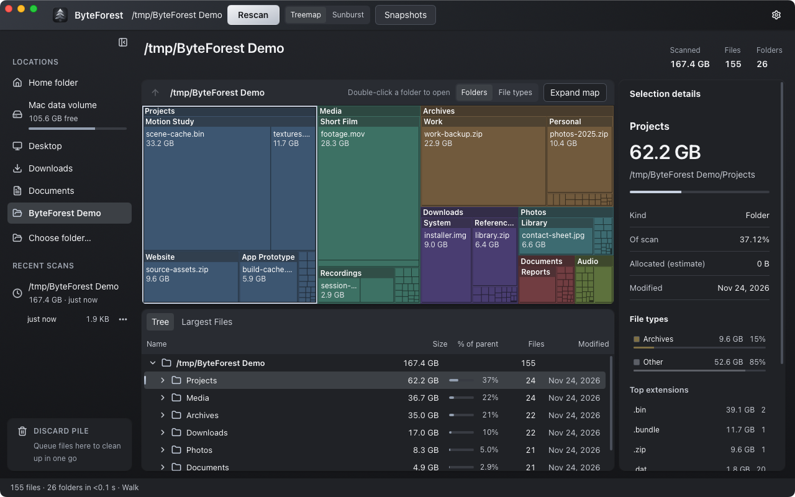
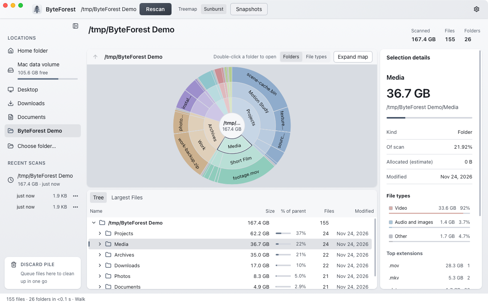
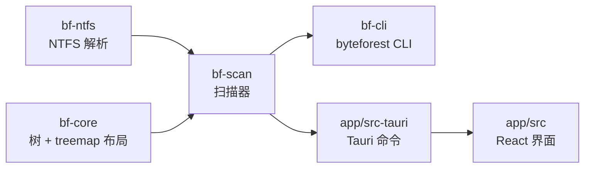

<p align="center">
  
</p>

<h1 align="center">ByteForest</h1>

<p align="center"><b>适用于 Windows 和 macOS 的快速开源磁盘空间分析器。</b></p>

<p align="center"><a href="README.md">English</a> | <a href="README.ru.md">Русский</a> | <a href="README.kk.md">Қазақша</a> | <b>简体中文</b> | <a href="README.es.md">Español</a> | <a href="README.de.md">Deutsch</a> | <a href="README.ja.md">日本語</a></p>

<p align="center">
  <a href="https://github.com/ErnarIT12/byteforest/actions/workflows/ci.yml"></a>
  <a href="https://github.com/ErnarIT12/byteforest/releases"></a>
  <a href="#许可证"></a>
  
  
</p>



*截图在 macOS 上使用虚构的演示数据拍摄。*

## 极速扫描：MFT 与目录遍历，支持排除规则

在 NTFS 卷上，ByteForest 直接读取主文件表（MFT），而不是逐个文件夹向 Windows 查询。这就是几秒与几分钟的差别。

| 扫描 | 模式 | 条目数 | 耗时 |
|---|---|---|---|
| Windows 11 电脑上的 `C:` | MFT（逐条记录），管理员权限 | 约 125 万 | 约 2.2 秒 |
| GitHub Actions runner | MFT | 约 120 万个文件 | 11.6 秒 |
| GitHub Actions runner | 目录遍历 | 约 120 万个文件 | 541 秒 |

以上是单台机器上的数据，并非正式基准测试；可以用 `byteforest bench` 测量你自己的机器（见[使用方法](#使用方法)）。

- NTFS 卷的 **MFT 扫描**。需要 Windows 和管理员权限。
- 当原始卷读取被阻止时（例如被反作弊驱动拦截）的**逐记录回退模式**：通过文件系统一次读取一条 MFT 记录，速度依然很快。
- 没有管理员权限、非 NTFS 卷，以及没有 MFT 扫描的 macOS 上，使用**目录遍历**。在大容量卷上会慢很多。
- **“Fast scan (admin)”按钮**（Windows）：以管理员权限重启 ByteForest，并自动继续扫描。开启 **“Always run as administrator”** 设置后，每次启动都很快。
- **扫描排除规则**：可在设置中排除在任意文件夹中匹配的名称和通配符（`*` 和 `?`，例如 `node_modules` 或 `*.tmp`），或扫描根目录下的绝对路径。被排除的内容不计入任何合计，状态栏会显示排除了多少。
- **全盘搜索**：在 **Largest Files** 中按名称、扩展名和最小大小搜索，还有一键预设，可快速找出常见的占空间大户（`node_modules`、`target`、`.venv`、`.git`、磁盘映像、超过 1 GB 的文件），并显示可释放的总大小。
- 任意文件夹的 **CSV 和 JSON 报告**，便于用于电子表格和脚本（**Export report…**）。
- 用于磁盘、扫描、快照、排除规则、报告和基准测试的**命令行工具**。

## 用 Treemap 和 Sunburst 交互式探索

- **文件夹树**，显示大小、占父文件夹的比例、文件数和修改日期。
- **Squarified treemap** 与 **Sunburst 磁盘图**，通过顶部栏的 **Treemap | Sunburst** 切换。两者都支持放大进入文件夹、面包屑、悬停提示、键盘操作和右键菜单。
- 树、地图和状态栏之间**选择保持同步**。双击打开文件夹；用面包屑、向上箭头或鼠标滚轮返回。
- 所选文件夹的**文件类型分布**（类别和主要扩展名），以及带图例的地图着色模式 **Folders / File types**。
- 树和地图上的**右键菜单**（也可用 Shift+F10）：打开、在 Explorer/Finder 中显示、复制路径，或确认后移到回收站。所有内容立即更新，无需重新扫描。



## Discard Pile、自动快照与差异对比

- **Discard Pile（待丢弃清单）**：从树、地图或检查器中把文件和文件夹加入清单（Delete 键或右键），在侧边栏查看累计大小，然后一步确认，全部移到回收站。确认之前不会删除任何内容，无法移动的项目会连同原因一起留在清单中。
- **快照**：把一次扫描保存为小巧的 `.bfsnap` 文件，之后用新的扫描与它对比，查看哪些增大、缩小或是新增。Changes 视图会列出增幅最大的项目。
- **两种地图上的差异高亮**：对比时，增大、新增和缩小的项目会在 treemap 和 sunburst 中用轮廓标出（实线、点线和虚线，并用标签显示大小变化）。
- **自动快照**：每次扫描完成后都会在后台保存（默认保留最近 10 个；在设置中可选 0 到 50 个，或关闭）。可从侧边栏即时以只读方式重新打开，无需重新扫描，也可与当前扫描对比。
- **命令行差异对比**：`byteforest scan <target> --save-snapshot <FILE>` 和 `--diff <FILE>`（见[使用方法](#使用方法)）。

## 极简界面与 100% 离线隐私

- 受 Radix 启发的**极简界面**，配有统一的左侧边栏：磁盘、桌面、下载和文档、最近的扫描以及 Discard Pile，并可折叠为图标栏。
- **Graphite（深色，默认）和 Silver（浅色）主题**，也可跟随系统，对比度符合 WCAG AA。悬停效果会遵循“减少动态效果”设置。
- **完全离线运行。** 没有遥测、没有账号、没有更新检查，代码也不发起任何网络请求。应用窗口只能与本地 Rust 后端通信，内容安全策略（CSP）不允许其他访问。
- **你的数据留在你的电脑上。** 设置保存在 `%APPDATA%\ByteForest\settings.json`，日志保存在 `%LOCALAPPDATA%\ByteForest\logs`。自动快照（已扫描项目的名称和大小）保存在 `%LOCALAPPDATA%\dev.byteforest.app\snapshots\auto`（macOS 上为 `~/Library/Application Support/dev.byteforest.app/snapshots/auto`），可在设置中关闭或限制数量。

## 安装

1. 打开 [Releases](https://github.com/ErnarIT12/byteforest/releases) 页面。
2. 下载以下之一：
   - 安装程序：`ByteForest_<版本>_x64-setup.exe`（NSIS）或 `ByteForest_<版本>_x64_en-US.msi`；
   - 便携命令行工具：`byteforest-cli-v<版本>-x64.zip`。
3. 可选：用同一发布中的 `SHA256SUMS.txt` 校验下载文件：`Get-FileHash <文件> -Algorithm SHA256`。

构建**尚未进行代码签名**，因此 Windows SmartScreen 会显示警告。如果你信任该下载，请选择“更多信息”，然后点击“仍要运行”。

安装程序会为所有用户将 ByteForest 安装到 Program Files。

系统要求：Windows 10/11 x64 和 WebView2（Windows 11 已预装；在 Windows 10 上缺失时安装程序会自动下载）。

### macOS 测试版

从 [GitHub Releases](https://github.com/ErnarIT12/byteforest/releases) 下载通用版 DMG，用 SHA256SUMS.txt 校验后，把 ByteForest 拖到“应用程序”文件夹。测试版需要 macOS 15 或更高版本，同时支持 Apple Silicon 和 Intel。应用采用 ad hoc 签名。由于没有经过 Apple 公证，首次启动时 Gatekeeper 可能会要求你在“隐私与安全性”中批准。[Apple 的首次启动说明](https://support.apple.com/en-us/102445)

ByteForest 提供你的个人文件夹、Mac 数据卷、本地挂载的磁盘以及系统原生的文件夹选择器。它以当前用户的权限遍历目录。被跳过的项目会在状态栏中提示。已分配大小只是估算值。APFS 克隆、共享块和快照可能导致扫描合计与卷的实际用量不一致。

## 使用方法

扫描完成后，打开 **Largest Files**，可在所有已扫描的文件夹中按名称、扩展名或大小搜索。选择一个结果，即可在树和地图中跳转到它。选中文件或文件夹后，可以复制路径或在 Explorer 或 Finder 中显示。

**应用。** 选择一个磁盘并点击 **Scan**，或点击 **Fast scan (admin)** 以提升权限重启并立即扫描。在树中选择文件夹，或在 treemap 中选择矩形（两者保持同步）。双击 treemap 中的文件夹即可放大；用面包屑、向上箭头或鼠标滚轮返回。

**排除。** 在设置（**Excluded from scans**）中添加名称或通配符（`node_modules`、`*.tmp`、`$RECYCLE.BIN`），它们在任何文件夹中都生效；完整路径（`C:\Windows\WinSxS`）只排除那一个文件夹。规则从下一次扫描起生效，位于扫描位置之外的路径会被忽略。状态栏会显示排除了多少内容。

**命令行。**

```text
byteforest drives                    # 列出可用磁盘
byteforest scan C: --top 20          # 扫描并输出最大的 20 项
byteforest scan C: --top 20 --json   # 同上，输出 JSON
byteforest bench C: --runs 3         # 扫描三次并计时
byteforest scan C: --save-snapshot before.bfsnap                         # 保存本次扫描的快照
byteforest scan C: --diff before.bfsnap                                  # 显示自快照以来的变化
byteforest scan C: --exclude node_modules --exclude "C:\Windows\WinSxS"  # 跳过指定名称和路径
byteforest scan D:\Projects --export report.csv --export-depth 3         # 写出 CSV 报告（也可用 .json）
```

要使用 MFT 扫描器，请在管理员终端中运行命令行工具。

## 从源码构建

前置条件：Rust（工具链在 `rust-toolchain.toml` 中固定）、带有 MSVC x64 工具链和 Windows SDK 的 Visual Studio Build Tools，以及 Node.js LTS。

```powershell
git clone https://github.com/ErnarIT12/byteforest.git
cd byteforest
npm --prefix app ci
npm --prefix app run tauri build   # 安装程序
cargo test --workspace             # 测试（先构建前端：npm --prefix app run build）
```

开发流程以及需要管理员权限的测试见 [CONTRIBUTING.md](CONTRIBUTING.md)。

在 macOS 上，请安装 Xcode Command Line Tools 和两个 Rust 目标，然后用 `npm --prefix app run tauri build -- --target universal-apple-darwin --bundles dmg` 构建。参见 [Tauri DMG 指南](https://v2.tauri.app/distribute/dmg/)。

## 架构



- `bf-ntfs`：基于字节切片的纯 NTFS 解析，不使用 Windows API。
- `bf-core`：树模型、大小聚合和 treemap 布局，不使用 Windows API。
- `bf-scan`：`MftScanner` 与 `WalkScanner`，以及自动模式选择。
- `bf-cli`：`byteforest` 命令行工具。
- `app`：Tauri 外壳（`src-tauri`）和 React + TypeScript 界面（`src`）。

扫描得到的树始终留在 Rust 中。界面只请求切片：某个文件夹的子节点（最多 1000 个）或某个 treemap 视图的矩形（最多 20 000 个）。

## 路线图

- 每个条目的内存占用降至 120 字节或更少（目前约 400 字节）。
- 基于 NTFS USN 日志的增量重新扫描。
- 本地化的界面。

## 参与贡献

欢迎提交 issue 和 pull request。请先阅读 [CONTRIBUTING.md](CONTRIBUTING.md) 和[行为准则](CODE_OF_CONDUCT.md)。

## 安全

请按照 [SECURITY.md](SECURITY.md) 中的说明私下报告漏洞。

## 许可证

可按你的选择采用以下任一许可证：

- Apache License, Version 2.0 ([LICENSE-APACHE](LICENSE-APACHE))
- MIT 许可证 ([LICENSE-MIT](LICENSE-MIT))

除非你另有明确说明，你有意提交以纳入本项目的任何贡献，均按上述方式双重许可，不附加任何其他条款或条件。

## 致谢

灵感来自 WinDirStat 和 WizTree 等磁盘分析器。极简界面的交互设计受 [Radix](https://github.com/colinvkim/Radix)（MIT）启发，未使用任何 Radix 代码。图标来自 [Lucide](https://lucide.dev)（ISC）。
