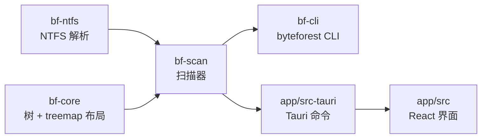

<p align="center">
  
</p>

<h1 align="center">ByteForest</h1>

<p align="center"><b>面向 Windows 的快速开源磁盘空间分析器：几秒钟看清是什么占满了你的磁盘。</b></p>

<p align="center"><a href="README.md">English</a> | <a href="README.ru.md">Русский</a> | <a href="README.kk.md">Қазақша</a> | <b>简体中文</b> | <a href="README.es.md">Español</a> | <a href="README.de.md">Deutsch</a> | <a href="README.ja.md">日本語</a></p>

<p align="center">
  <a href="https://github.com/ErnarIT12/byteforest/actions/workflows/ci.yml"></a>
  <a href="https://github.com/ErnarIT12/byteforest/releases"></a>
  <a href="#许可证"></a>
  
</p>


*截图中的数据均为虚构的演示数据，由 [`scripts/make-demo-data.ps1`](scripts/make-demo-data.ps1) 生成。*

## 为什么选择 ByteForest

在 NTFS 卷上，ByteForest 直接读取主文件表（MFT），而不是逐个文件夹向 Windows 查询。这就是几秒与几分钟的差别。

| 扫描 | 模式 | 条目数 | 耗时 |
|---|---|---|---|
| Windows 11 电脑上的 `C:` | MFT（逐条记录），管理员权限 | 约 125 万 | 约 2.2 秒 |
| GitHub Actions runner | MFT | 约 120 万个文件 | 11.6 秒 |
| GitHub Actions runner | 目录遍历 | 约 120 万个文件 | 541 秒 |

没有管理员权限时，ByteForest 会退回到普通的目录遍历，速度慢得多。以上是单台机器上的数据，并非正式基准测试；可以用 `byteforest bench` 测量你自己的机器（见[使用方法](#使用方法)）。

## 功能

- 拥有管理员权限时对 NTFS 卷进行 **MFT 扫描**。
- 当原始卷读取被拦截（例如反作弊驱动）时，**逐条记录的回退模式**：通过文件系统一条一条读取 MFT 记录，速度依然很快。
- 没有管理员权限或非 NTFS 卷时的**目录遍历回退**。
- 带有大小、占父级比例、文件数和修改日期的**文件夹树**。
- 支持放大到文件夹、面包屑导航和悬停提示的 **squarified treemap**。
- 树、treemap 与状态栏之间的**同步选择**。
- **“Fast scan (admin)”按钮**：以管理员权限重新启动 ByteForest，并自动继续扫描。
- **“Always run as administrator”** 设置，让每次启动都是快速模式。
- **Graphite（深色）与 Silver（浅色）主题**，或跟随系统，对比度符合 WCAG AA。
- 文件夹树和 treemap 的**右键菜单**：打开、在资源管理器/Finder 中显示、复制路径，或确认后移至回收站/废纸篓。树、treemap 和总计会立即更新，无需重新扫描。
- 所选文件夹的**文件类型分布**（类别和主要扩展名），以及 treemap 的 **Folders / File types** 配色模式。
- 针对常见占空间大户（`node_modules`、`target`、`.venv`、`.git`、磁盘镜像、超过 1 GB 的文件）的**一键搜索预设**，并显示可释放的总大小。
- **快照与对比**：把一次扫描保存为小文件，之后用新的扫描与它对比，查看哪些增长、缩小或是新增。
- **扫描排除**：在设置中排除名称、通配符（`node_modules`、`*.tmp`）或完整路径。被排除的内容不计入任何总计。
- 为表格和脚本提供任意文件夹的 **CSV 和 JSON 报告**（**Export report…**）。
- 用于列出磁盘、扫描、快照、排除、报告和基准测试的**命令行工具**。


## 安装

1. 打开 [Releases](https://github.com/ErnarIT12/byteforest/releases) 页面。
2. 下载以下之一：
   - 安装程序：`ByteForest_<版本>_x64-setup.exe`（NSIS）或 `ByteForest_<版本>_x64_en-US.msi`；
   - 便携命令行工具：`byteforest-cli-v<版本>-x64.zip`。
3. 可选：用同一发布中的 `SHA256SUMS.txt` 校验下载文件：`Get-FileHash <文件> -Algorithm SHA256`。

构建**尚未进行代码签名**，因此 Windows SmartScreen 会显示警告。如果你信任该下载，请选择“更多信息”，然后点击“仍要运行”。

安装程序会为所有用户将 ByteForest 安装到 Program Files。

系统要求：Windows 10/11 x64 和 WebView2（Windows 11 已预装；在 Windows 10 上缺失时安装程序会自动下载）。

## 使用方法

**应用。** 选择一个磁盘并点击 **Scan**，或点击 **Fast scan (admin)** 以提升权限重启并立即扫描。在树中选择文件夹，或在 treemap 中选择矩形（两者保持同步）。双击 treemap 中的文件夹即可放大；用面包屑、向上箭头或鼠标滚轮返回。

**排除。** 在设置（**Excluded from scans**）中添加名称或通配符（`node_modules`、`*.tmp`、`$RECYCLE.BIN`），它们在任何文件夹中都生效；完整路径（`C:\Windows\WinSxS`）只排除那一个文件夹。规则从下一次扫描起生效，位于扫描位置之外的路径会被忽略。状态栏会显示排除了多少内容。

**命令行。**

```text
byteforest drives                    # 列出可用磁盘
byteforest scan C: --top 20          # 扫描并输出最大的 20 项
byteforest scan C: --top 20 --json   # 同上，输出 JSON
byteforest bench C: --runs 3         # 扫描三次并计时
byteforest scan C: --save-snapshot before.bfsnap                         # 保存本次扫描的快照
byteforest scan C: --diff before.bfsnap                                  # 显示自快照以来的变化
byteforest scan C: --exclude node_modules --exclude "C:\Windows\WinSxS"  # 跳过指定名称和路径
byteforest scan D:\Projects --export report.csv --export-depth 3         # 写出 CSV 报告（也可用 .json）
```

要使用 MFT 扫描器，请在管理员终端中运行命令行工具。

## 从源码构建

前置条件：Rust（工具链在 `rust-toolchain.toml` 中固定）、带有 MSVC x64 工具链和 Windows SDK 的 Visual Studio Build Tools，以及 Node.js LTS。

```powershell
git clone https://github.com/ErnarIT12/byteforest.git
cd byteforest
npm --prefix app ci
npm --prefix app run tauri build   # 安装程序
cargo test --workspace             # 测试（先构建前端：npm --prefix app run build）
```

开发流程以及需要管理员权限的测试见 [CONTRIBUTING.md](CONTRIBUTING.md)。

## 架构



- `bf-ntfs`：基于字节切片的纯 NTFS 解析，不使用 Windows API。
- `bf-core`：树模型、大小聚合和 treemap 布局，不使用 Windows API。
- `bf-scan`：`MftScanner` 与 `WalkScanner`，以及自动模式选择。
- `bf-cli`：`byteforest` 命令行工具。
- `app`：Tauri 外壳（`src-tauri`）和 React + TypeScript 界面（`src`）。

扫描得到的树始终留在 Rust 中。界面只请求切片：某个文件夹的子节点（最多 1000 个）或某个 treemap 视图的矩形（最多 20 000 个）。

## 隐私

ByteForest 完全离线运行。它没有遥测，代码也不发起任何网络调用；应用窗口只能与本地 Rust 后端通信（内容安全策略不允许其他访问）。设置保存在 `%APPDATA%\ByteForest\settings.json`，日志保存在 `%LOCALAPPDATA%\ByteForest\logs`，都在你自己的电脑上。

## 路线图

- 每个条目的内存占用降到 120 字节或更低（目前约 400）。
- 与 treemap 并列的 Sunburst（旭日图）视图。
- Discard Pile：集中收集项目并一起删除。
- 自动快照。
- 基于 NTFS USN 日志的增量重新扫描。
- 本地化界面。

## 参与贡献

欢迎提交 issue 和 pull request。请先阅读 [CONTRIBUTING.md](CONTRIBUTING.md) 和[行为准则](CODE_OF_CONDUCT.md)。

## 安全

请按照 [SECURITY.md](SECURITY.md) 中的说明私下报告漏洞。

## 许可证

可按你的选择采用以下任一许可证：

- Apache License, Version 2.0 ([LICENSE-APACHE](LICENSE-APACHE))
- MIT 许可证 ([LICENSE-MIT](LICENSE-MIT))

除非你另有明确说明，你有意提交以纳入本项目的任何贡献，均按上述方式双重许可，不附加任何其他条款或条件。

## 致谢

灵感来自 WinDirStat、WizTree 和 [Radix](https://github.com/colinvkim/Radix) 等磁盘分析器。
